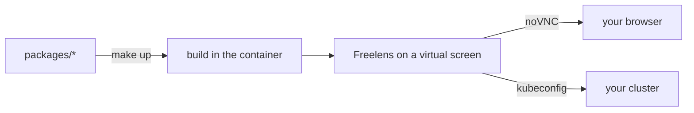

# freelens-addons

Extensions for [Freelens](https://freelens.app). Each one ships as its own `.tgz` and installs on
its own.

## Extensions

| Extension | What it shows | Writes | Docs |
|-----------|---------------|--------|------|
| ArgoCD | Applications ordered by what is wrong, with row actions | Yes | [argocd.md](docs/argocd.md) |
| Trivy | Scan coverage first, then findings and upgrades | No | [trivy.md](docs/trivy.md) |
| cert-manager | Certificates that will fail to renew, and why | Renew | [cert-manager.md](docs/cert-manager.md) |
| CloudNativePG | Postgres clusters that need attention, and whether each can be restored | Yes | [cnpg.md](docs/cnpg.md) |
| MongoDB | MongoDB clusters that need attention, and which member is primary | Yes | [mongodb.md](docs/mongodb.md) |
| Redis | Redis setups that need attention, and which pod is master | Yes | [redis.md](docs/redis.md) |
| OpenTelemetry | Workloads running without their agent, and crashing collectors | Restart | [opentelemetry.md](docs/opentelemetry.md) |
| Prometheus | Monitors and rules nothing scrapes, and node and pod usage | No | [prometheus.md](docs/prometheus.md) |

Tested versions: [distribution.md](docs/distribution.md#compatibility).

## Installing

Download a release's `.tgz` and install it from File > Extensions. It starts disabled. Steps,
enabling, and what to check when the group is missing: [distribution.md](docs/distribution.md).

## Developing

You need Docker and a kubeconfig. Node, pnpm and Freelens run in the container.

Run `make up`, set `KUBECONFIG_PATH` in the `.env` it writes, and run it again. Freelens opens at
`http://localhost:6080/vnc.html?autoconnect=1&resize=scale`. The rest is in
[development.md](docs/development.md); a disposable cluster is in
[dev/cluster/README.md](dev/cluster/README.md).

## Documentation

| Document | Contents |
|----------|----------|
| One page per extension | Linked in the table above |
| [development.md](docs/development.md) | The loop, commands, adding an extension |
| [architecture.md](docs/architecture.md) | The workbench container and what the extension loader requires |
| [testing.md](docs/testing.md) | Test approach and where fixtures come from |
| [distribution.md](docs/distribution.md) | Installing, enabling and cutting a release |
| [security.md](docs/security.md) | Supply-chain rules and what CI enforces |
| [kubernetes-mcp.md](docs/kubernetes-mcp.md) | The read-only Kubernetes MCP the agent uses on the dev k3s |

## Licence

Apache 2.0.
