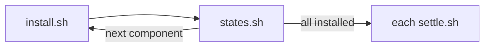

# Development cluster

A disposable k3s to develop the extensions against. The kubeconfig goes to
`/tmp/freelens-addons-k3s/kubeconfig.yaml`, outside the repository.

| Command | What it does |
|---------|--------------|
| `make cluster` | Start k3s and install every component |
| `make cluster PACKAGE=cnpg` | Install only what that package's e2e suites need, as its CI leg does. Run `make cluster-down` first for a cluster with nothing else |
| `make cluster-down` | Stop it and delete its data |

## Contents

- [cluster.sh](#clustersh)
- [What gets installed](#what-gets-installed)
- [States no manifest declares](#states-no-manifest-declares)
- [Changing the seed](#changing-the-seed)
- [Helpers](#helpers)

## cluster.sh

Everything that touches this cluster goes through `cluster.sh`, which refuses any other.

| Command | What it does |
|---------|--------------|
| `cluster.sh install [component...]` | Installs every component in `COMPONENTS` order, or only those named. `make cluster` runs it |
| `cluster.sh install --for cnpg` | Installs what that package needs, from `NEEDS`. `make cluster PACKAGE=cnpg` runs it |
| `cluster.sh settle prometheus` | Runs that component's `settle.sh` again, for a state that expired |
| `cluster.sh rejections` | Has the Prometheus operator emit its expired rejection Events again; `make e2e` runs it |
| `cluster.sh fixtures [package...]` | Writes the test fixtures, from a full install only ([testing](../../docs/testing.md#fixtures)) |

## What gets installed

One directory per component under `components/`:

| File | What it does |
|------|--------------|
| `install.sh` | Installs the tool at a pinned version and applies the samples |
| `*.yaml` | The samples, in each state the pages render |
| `states.sh` | Causes the states no manifest can declare. Optional |
| `settle.sh` | Waits for asynchronous results the e2e suites read once. Optional |

| Directory | Needs | Installs | Samples |
|-----------|-------|----------|---------|
| `workloads/` | — | Nothing | Workloads in `demo` for Trivy to flag: root with no limits, one never ready, one whose image does not exist, a ClusterRole reading secrets cluster-wide |
| `argocd/` | — | ArgoCD, Argo CD Image Updater | Applications synced, failing on a missing path, revision or namespace, with automated sync off, an app-of-apps, a multi-source one, one pinned to a commit. An unused scoped AppProject. Image Updater rules in each state. ApplicationSets: `guestbooks`, and `broken-template`, which always fails |
| `trivy/` | `workloads` | Trivy operator | `stalled`, a rollout that never finishes: its old ReplicaSet is "No verdict" |
| `cert-manager/` | — | cert-manager | `demo-ca`, the chain the other components' certificates come from |
| `cert-manager-samples/` | `cert-manager` | Pebble, a test ACME server | Issuers, Certificates and Ingresses in each state the pages render |
| `cnpg/` | `cert-manager` | CloudNativePG, Barman Cloud plugin, RustFS as S3 | Postgres clusters (one a replica cluster), backups, schedules, poolers, roles, publications and subscriptions |
| `mongodb/` | `cert-manager` | MongoDB Controllers for Kubernetes | Replica sets in each state, and a healthy one in a second watched namespace, `mongodb-apps` |
| `redis/` | `cert-manager` | redis-operator | A replication with sentinels, a cluster, a standalone with TLS, one whose volume cannot bind, and a replication whose image does not exist |
| `opentelemetry/` | `cert-manager` | OpenTelemetry Operator | Collectors, and workloads opted in to auto-instrumentation in each Coverage state, blocked ones included |
| `prometheus/` | `cert-manager`, `opentelemetry` | Prometheus Operator, node-exporter | Instances, monitors and rules in each state the pages rank; a collector whose TargetAllocator selects monitors |

`argocd/image-updater-refused.yaml` is never seeded: it makes the controller crash-loop.
`cluster.sh fixtures argocd` applies it for the export and removes it.

## States no manifest declares

| State | How |
|-------|-----|
| A certificate valid while its renewal fails | `flaky-ca` loses its key, so `renewal-stalls` stops renewing |
| A failed re-issue while the old certificate is served | `out-of-date` moves to the Pebble issuer, whose blocklist refuses its name |
| A Secret left behind | `retired-tls`'s Certificate is deleted once issued |
| A deploy history | `guestbook` is synced by hand several times |
| Drift that stays | `helm-guestbook` has no automated sync and its Deployment is scaled |
| A ReplicaSet scaled away | `web` is rolled once: the old ReplicaSet keeps its SBOM, loses its config audit, and reads Scaled away |
| A switchover, a hibernated cluster, a stopped replica | `cnpg/states.sh` |
| An upgrade and a memory change stopped halfway | `upgrade-rs` and `ledger-rs` in `mongodb/states.sh` |
| A workload opted in after its pods started | `otel-late`'s Namespace is annotated once its pods run |
| A CronJob's run | Job `nightly-run` is created from `otel-batch/nightly` |
| Pressure on the node | k3s flags in `dev/docker-compose.yml` make image garbage collection unreachable |

## Changing the seed

| Rule | Why |
|------|-----|
| Fetch upstream manifests at a release tag | Tags follow the 15-day floor, so the pin is often not the newest |
| Apply server-side (`apply_url`) | Some CRDs, such as ArgoCD's ApplicationSet, are too big for a client-side apply |
| A state to cause goes into `states.sh` | `settle.sh` only waits; Prometheus's re-labels to re-emit rejections, nothing else changes |
| A component another needs goes into that package's `NEEDS`, in install order | The full seed hides a missing one; `make cluster PACKAGE=<name>` on a fresh cluster shows it |
| Every fixture comes from this cluster | The repository is public; never hand-write one ([testing](../../docs/testing.md#fixtures)) |
| A new extension adds its component, `NEEDS` entry and CI leg | `scripts/checks/e2e-legs.sh` fails until they name the same set |

The sample TLS Secrets hold placeholders, so `tls: failed to find any PEM data` on apply is expected.

## Helpers

`cluster.sh` defines these for `install.sh`, `states.sh` and `settle.sh`:

| Helper | What it does |
|--------|--------------|
| `namespace NAME` | Creates the namespace if missing |
| `apply FILE...` | `kubectl apply -f` each file |
| `apply_url URL...` | Applies each URL server-side, retried |
| `wait_deploy NAMESPACE DEPLOYMENT...` | Waits for each rollout |
| `retry COMMAND...`, `retry_for SECONDS COMMAND...` | Runs the command until it succeeds or times out |
