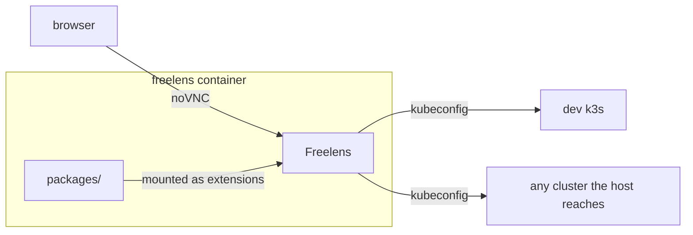
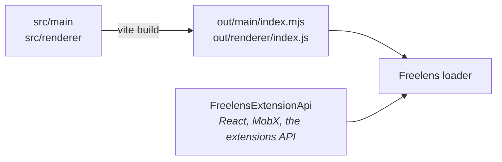

# Workbench architecture

Freelens runs in a container on a virtual screen, and you watch it through noVNC. The same
container builds the extensions. `packages/` is mounted where Freelens reads extensions, so a build
is also the install.

## Contents

- [The workbench](#the-workbench)
- [From source to a loaded extension](#from-source-to-a-loaded-extension)
- [What a build must produce](#what-a-build-must-produce)

## The workbench

| Piece | What to know |
|-------|--------------|
| `freelens` container | On the host network, so it reaches a cluster behind the host's VPN. Builds and tests run in it too |
| `k3s` container | Only with `make cluster`. Its API listens on `127.0.0.1` |
| `packages/` | Mounted read-only at `<userData>/extensions`. Every directory there must be an extension; shared code lives in `build/` |
| `seed-extensions.mjs` | Freelens installs an extension disabled. This enables each one the first time it sees it |

## From source to a loaded extension

Each extension's `vite.config.ts` re-exports `build/vite/extension-config.ts`. Nothing from npm is
bundled: the host provides React, MobX and the API ([security](security.md#vulnerabilities)).

## What a build must produce

Freelens skips an extension that misses one of these, without an error.
`scripts/checks/verify-bundles.sh` checks them all.

| Requirement | Handled by |
|-------------|------------|
| The manifest names `main`, `renderer` and `engines.freelens: ^2.0.0` | Each `package.json` |
| One ES module per entrypoint, its default export a class | `build/vite/extension-config.ts` |
| Host libraries come from `globalThis.FreelensExtensionApi`, never bundled | `build/vite/global-externals.ts` |
| No Node or Electron in the renderer; file work goes to main over IPC | `build/vite/extension-config.ts` |
