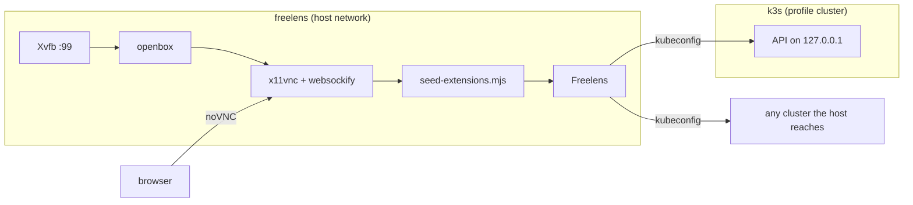

# Workbench architecture

The `freelens` container runs Freelens on a virtual screen, serves it over noVNC, and holds the
Node and pnpm that build the extensions. `packages/` is mounted where Freelens reads extensions, so
a build is also the install.

## Contents

- [Containers](#containers)
- [Host networking](#host-networking)
- [The extensions directory is the workspace](#the-extensions-directory-is-the-workspace)
- [What the loader requires](#what-the-loader-requires)
- [Build pipeline](#build-pipeline)
- [Notes](#notes)

## Containers

| Service | Role |
|---------|------|
| `freelens` | Built from `dev/freelens`. `docker compose up` runs the app; `run --entrypoint sh` runs a build or tests without it |
| `k3s` | Started only by `make cluster`. For development only; a user installs a tarball |

The entrypoint starts each step after the previous one is ready, and Freelens last, under
`dbus-run-session`.

## Host networking

`freelens` uses `network_mode: host`, so it reaches a cluster behind the host's VPN.

| Effect | Detail |
|--------|--------|
| Ports | noVNC listens on `NOVNC_PORT` directly; a port in use fails the start |
| k3s | Stays on its own network and publishes `127.0.0.1:${K3S_PORT}` (6443 by default). On the host network flannel would write bridges and iptables there |

## The extensions directory is the workspace

`./packages` is mounted read-only at `~/.freelens/extensions`, and Freelens loads every subdirectory
with a `package.json`. A helper package there breaks discovery, since Freelens reads
`engines.freelens` without checking it exists. Shared build code lives in `build/`.

## What the loader requires

Each failure is silent, so each is handled once, in shared code.

| Requirement | Why | Handled by |
|-------------|-----|------------|
| `main`, `renderer` and `engines.freelens` in the manifest | `engines.freelens` must start with `^` or a digit; a mismatch lists it as incompatible | Each `package.json` |
| `.default` is a class | The loader does `new (require(entry).default)()`; Rollup's `exports: "auto"` leaves it undefined | `build/vite/extension-config.ts` |
| Host libraries read from globals | A second React or MobX breaks hooks and observability | `build/vite/global-externals.ts` |
| A link in Freelens' `node_modules` | Freelens makes it only for an extension that appears while it runs | `dev/freelens/seed-extensions.mjs` |

| Process | Globals the build maps |
|---------|------------------------|
| main | `LensExtensions`, `Mobx` |
| renderer | Those, plus `MobxReact`, `React`, `ReactDOM`, `ReactJsxRuntime`, `ReactRouter`, `ReactRouterDom` |

`seed-extensions.mjs` runs before Freelens. It creates the missing links, enables an extension the
first time it sees it (one disabled later in the UI stays disabled). A state file it creates carries a
migration marker, so Freelens does not drop the seed at boot.

## Build pipeline

Every extension re-exports `build/vite/extension-config.ts`: one CommonJS file with a sourcemap per
entrypoint.

| Setting | Reason |
|---------|--------|
| `exports: "named"` | Keeps `.default` |
| Not minified | Readable stack traces |
| Dynamic imports inlined | The loader does one `require` and has no chunk loader |
| Renderer built in the `preload` slot | electron-vite's `renderer` slot demands an `index.html` |

## Notes

| Topic | Rule |
|-------|------|
| Reloading | A rebuild does not reload: see [development](development.md#the-loop) |
| noVNC URL | Use `resize=scale`; Xvfb has a fixed size, so `resize=remote` crops the desktop |
| `ReactDOM` | Upstream's example extension reads `global.ReactDom`, which is undefined |
| `build/` as a workspace package | pnpm 12.3.4 writes broken root symlinks for peer-suffixed packages, so `build/` owns `vite` and `electron-vite` |
| Named volumes | Created and chowned at image build, or they appear root-owned to the unprivileged user |
