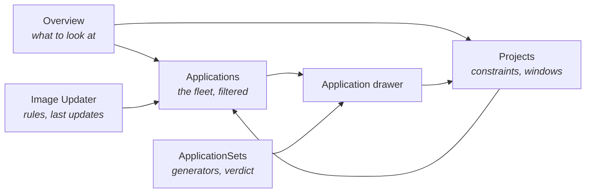

# ArgoCD extension

Shows which ArgoCD Applications need attention, worst first, with the reason and the action on the
same row. It uses the kubeconfig Freelens already holds, so no ArgoCD login is needed.

## Contents

- [Pages](#pages)
- [Features](#features)
- [Actions](#actions)

## Pages

A card opens the list it counts. A link to one Application opens the list with its drawer open.
ApplicationSets and Image Updater show only where their CRDs exist.

## Features

| Page | Shows |
|------|-------|
| Overview | How many Applications need attention and why, worst first; pins; node pressure; repeated syncs; recent rollouts |
| Applications | Sync, health, drift, revision and destination. The drawer adds sources, conditions, resources, images and deploy history |
| Projects | Allowed sources and destinations, roles, sync windows, frozen or not, and its Applications |
| ApplicationSets | Generators, owned Applications and a verdict from the conditions, failing first. Read only |
| Image Updater | Rules that fail or match nothing, how each image picks a tag, and each rule's last update. Needs v1.0 or later |

## Actions

Every write asks first. One that deletes, or reaches several Applications, also asks for a typed
word. A write with a simple reverse offers Undo.

| Action | Note |
|--------|------|
| Refresh, Hard refresh | Compares with git again; changes nothing in the cluster |
| Sync | Prune and Force off unless ticked. From the overview it never prunes |
| Sync several | Ticked rows, the overview or Sync all; skips Applications already syncing |
| Terminate | Stops a sync in flight |
| Roll back | Syncs one of the last three deploys and pauses auto-sync |
| Freeze, Resume | Adds or removes a deny sync window on the project |
| Pin, Unpin | Keeps an Application at the top of the overview |
| Logs, What changed in git | The first pod's logs; the git diff since the previous deploy |
| Image Updater | Check now, edit an image, undo an update, delete a rule |
| Copy commands | `argocd`, `kubectl` and a status summary |
