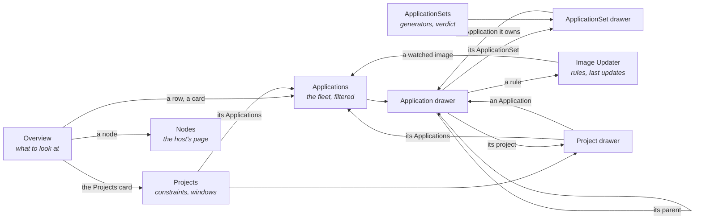

# ArgoCD extension

Shows which ArgoCD Applications need attention, worst first, with the reason and the action on the
same row. It uses the kubeconfig Freelens already holds, so no ArgoCD login is needed.

## Contents

- [Pages](#pages)
- [Overview](#overview)
- [Applications and Projects](#applications-and-projects)
- [ApplicationSets](#applicationsets)
- [Image Updater](#image-updater)
- [Actions](#actions)

## Pages

| Every page | Behaviour |
|------------|-----------|
| Namespaces | The host's namespace selector narrows the page |
| Loading | Says it is connecting until the lists load, never "none" too early |
| Refused namespaces | Named in a banner; the others still show |
| Links | A link to one Application opens the list with its drawer open |

## Overview

| Feature | What it shows |
|---------|---------------|
| Headline | How many Applications need attention, whatever the filters hide |
| Headline menu | ArgoCD's component logs, and its web UI when its address is found |
| Cards | Applications, Projects, and counts by sync, health and no auto-sync; each opens the list it counts |
| Needs attention | Degraded, stuck, failed or not comparable, worst first, with the drifting resources |
| Pins | Applications kept at the top, per cluster |
| Cluster pressure | Node conditions and the last hour's node warnings |
| Syncing repeatedly | Applications that sync over and over |
| Recent rollouts | Deploys grouped by revision |
| What the next commit can move | The repositories and references the Applications follow |

## Applications and Projects

| Where | Features |
|-------|----------|
| Applications list | Sync and health, drift, revision, destination; bulk Refresh, Hard refresh and Sync |
| Application drawer | Its overview finding as a banner; project and owner as links |
| Application drawer | Sources, auto-sync, last sync, conditions, resources, images, deploy history |
| Application drawer | Commands to look further; the Image Updater rules that watch its images |
| Projects list | Allowed sources and destinations, roles, sync windows, frozen or not, its Applications |
| Project drawer | Frozen banner, sync windows, roles, allowed and denied kinds, its Applications |
| Project menu and ticked projects | Refresh all, Sync all, Freeze, Resume |

## ApplicationSets

Read only. Shown only where the `ApplicationSet` CRD exists.

| Where | Features |
|-------|----------|
| List | Generators, owned Applications with sync and health summed, a verdict from the conditions; failing first; searched and sorted |
| Drawer | Verdict banner, generators, whether it uses Go templates, the template, sync policy, owned Applications, conditions |

A verdict reads Not reported until the controller writes a condition. Owned Applications are found
by owner reference, so same-named sets in two control planes stay apart.

## Image Updater

For [Argo CD Image Updater](https://argocd-image-updater.readthedocs.io/) v1.0 or later. Shown only
where the `ImageUpdater` CRD exists.

| Screen | Features |
|--------|----------|
| Overview | Rules failing, erroring, not checking or matching nothing; counts; Check now |
| Rules | State, Applications, images, last check and update; Delete on ticked rules |
| Images | How each image picks a tag, the Application it reaches, the tag it runs; Edit |
| Updates | Each rule's last update, from which tag to which; Undo |
| Rule drawer | Last update, images, controller log, commands; Delete |

Rules, Images and Updates are searched and sorted by any column.

## Actions

Every write asks first. A write that deletes, or that reaches several Applications or projects from
a selection or a Sync all, also asks for a typed word; freezing one project does not. A write with a
simple reverse offers Undo in its notification.

| Action | Note |
|--------|------|
| Logs | Opens the logs of the Application's first pod |
| What changed in git | Opens the git diff since the previous deploy, when the repository gives one |
| Refresh, Hard refresh | Compares with git again; changes nothing in the cluster |
| Sync | Prune and Force off unless ticked; either asks for the Application's name |
| Sync several | Ticked rows, the overview or Sync all; type `confirm`; skips Applications already syncing |
| Terminate | Stops a sync in flight |
| Roll back | Syncs one of the last three deploys; pauses auto-sync, and Resume auto-sync restores it |
| Freeze, Resume | Adds or removes a deny sync window on the project |
| Pin, Unpin | Keeps an Application at the top of the overview |
| Copy commands | `argocd`, `kubectl` and a status summary |
| Check now | Restarts the Image Updater controller |
| Edit an image | Constraint, strategy, allowed tags |
| Undo an update | Puts the previous tag back, when the rule allows it |
| Delete a rule | After typing its name |

Sync several from the overview never prunes; the ticked rows and Sync all offer Prune and Force.
Roll back warns when an ApplicationSet or a self-healing parent would undo it.
