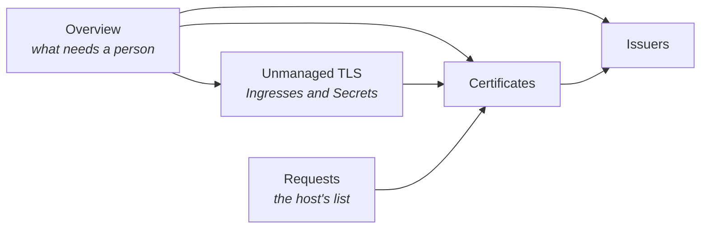
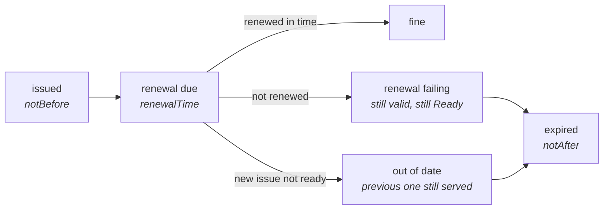

# cert-manager extension

Shows which certificates will not be there when needed (expiring, stuck, or managed by nothing) and
which object is holding each one up. Its only write is a renewal you ask for; everything else is a
command to copy. It never reads Secret data.

## Contents

- [Pages](#pages)
- [Renewal](#renewal)
- [The chain](#the-chain)
- [Features](#features)

## Pages

## Renewal

## The chain

The drawer's Issuance chain marks the link that explains the state, a broken issuer first.

## Features

| Page | Shows |
|------|-------|
| Overview | Expired, not ready, out of date and renewal failing, worst first; cards that open their list |
| Certificates | State, issuer, expiry and renewal. The drawer adds the cause, the validity bar, failed attempts and the chain |
| Issuers | Issuers, ClusterIssuers and missing ones a certificate names, broken first |
| Requests | The host's list of CertificateRequests; unapproved ones read Awaiting approval |
| Unmanaged TLS | Ingresses and TLS Secrets no Certificate writes, gaps first |

Renew now does what `cmctl renew` does and asks first. It is refused, with nothing written, if the
certificate changed or you may not patch `certificates/status`. Ticked rows renew in bulk after you
type `confirm`.
