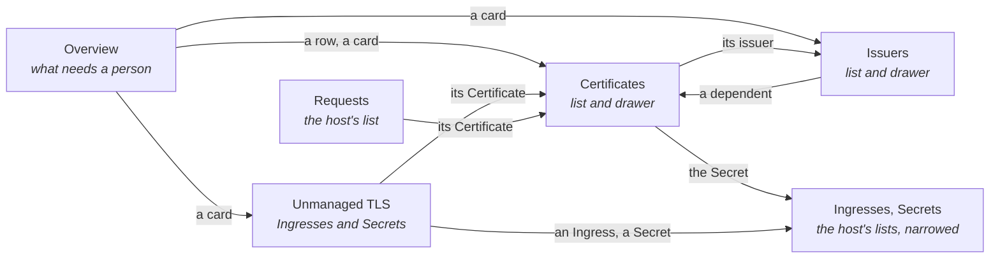
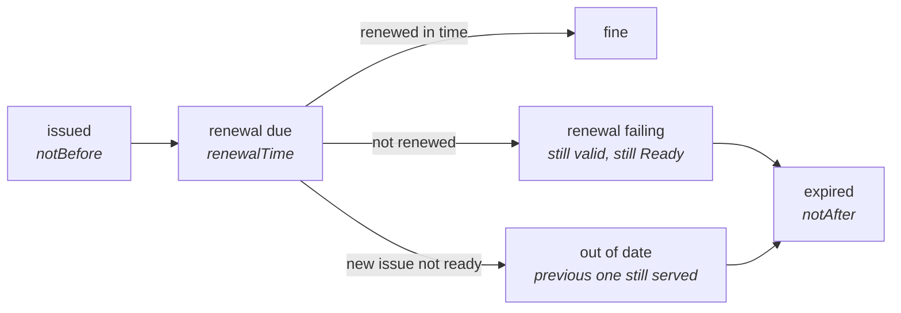

# cert-manager extension

Shows which certificates will not be there when needed (expiring, stuck, or managed by nothing) and
which object is holding each one up. Its only write is a renewal you ask for; everything else is a
command to copy. It never reads Secret data.

## Contents

- [Pages](#pages)
- [Renewal](#renewal)
- [The chain](#the-chain)
- [Features](#features)

## Pages

## Renewal

## The chain

The drawer's Issuance chain marks the link that explains the state, a broken issuer first.

## Features

| Page | Features |
|------|----------|
| Every page | The host's namespace selector; ClusterIssuers always show |
| Loading | Says it is connecting (the overview shows a spinner); without cert-manager's CRDs it says it is waiting for them |
| Refused lists | Named in a banner; what depends on them reads unknown, never missing or fine |
| Overview | Expired, not ready, out of date and renewal failing, worst first |
| Overview cards | All, not ready, out of date, renewal failing, ending within 7 and 30 days, issuers in trouble, served TLS with no Certificate |
| Overview cards | Each card but the 7-day one opens its list on the matching chip |
| Certificates list | State, issuer, expiry and renewal; searched, sorted, filtered by chips; late renewals marked |
| Certificates drawer | State and cause, issuer and Secret as links, validity bar, failed attempts and next try, the chain, commands |
| Renew now | Same as `cmctl renew`; asks first; hidden while cert-manager is issuing; warns when the issuer is broken |
| Renew now | Refused, with nothing written, if the certificate changed or the user may not patch `certificates/status` |
| Bulk renew | Tick, Renew, type `confirm`; skips those already issuing |
| Issuers | Issuers, ClusterIssuers and missing ones named by a certificate, broken first |
| Issuer drawer | Type, state, ACME account or CA Secret, dependent certificates, a command |
| Requests | The host's list of CertificateRequests; unapproved ones read Awaiting approval |
| Unmanaged TLS: Ingresses | Ingresses serving a Secret no Certificate writes, missing or still issuing; gaps first |
| Unmanaged TLS: Secrets | TLS Secrets without a Certificate, including one left by a deleted Certificate |
| Unmanaged TLS: loading | Nothing is judged until Ingresses and Certificates list; Secrets refused cluster-wide are listed per namespace |
