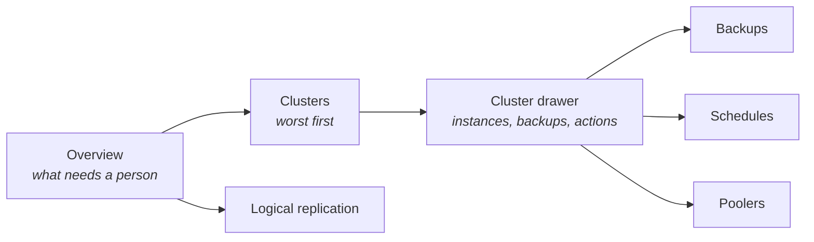
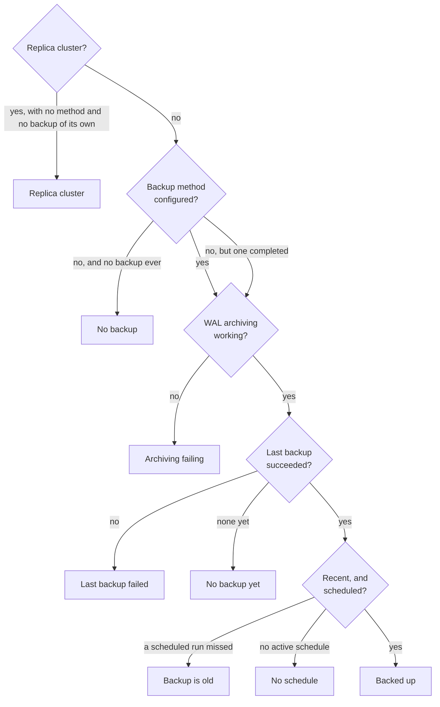

# CloudNativePG extension

Shows which Postgres clusters run by [CloudNativePG](https://cloudnative-pg.io/) need attention,
and whether each one can be restored from its backups. A cluster can be up while its WAL archive
has been failing for days; this extension puts the two side by side.

## Contents

- [Pages](#pages)
- [Can it be restored?](#can-it-be-restored)
- [Features](#features)
- [Actions](#actions)
- [What it will not do](#what-it-will-not-do)

## Pages

The group appears only where `clusters.postgresql.cnpg.io` exists. A card opens its list filtered to
the rows it counts. Every list links back to its cluster; pods, nodes, volumes and Secrets open the
host's lists.

## Can it be restored?

- **Sources:** the Barman Cloud plugin's `ObjectStore`, the in-tree `barmanObjectStore` and volume
  snapshots.
- **Replica cluster:** restored from its source's backups.
- **Old backup:** the most frequent active schedule missed a run; without one, older than about a day.
- **Failure cause:** read from the instance's log, since the operator keeps only an exit status.

## Features

| Page | Shows |
|------|-------|
| Overview | Cards per state, and what needs attention, worst first: clusters, replicas, certificates, volumes, schedules, poolers |
| Clusters | State, instances, version, primary, worst replica lag, backup state and last backup |
| Cluster drawer | Status and connection URLs, instances and slots, health, logs, backups, schedules, poolers |
| Backups | State, error when it failed, method, duration and age |
| Schedules | Active, suspended or failing, and when it runs, in words |
| Poolers | Active, paused, degraded, or in front of a missing cluster |
| Logical replication | Publications and subscriptions, applied or the operator's reason |

Replica states, shown in the instance list, the clusters list's lag and the overview:

| State | Meaning |
|-------|---------|
| Not streaming | The primary reports no streaming connection from it |
| Replay paused | Paused by hand |
| Lagging | Far behind the primary |

## Actions

Every write asks first. While a cluster is hibernated, every write to it is refused except Wake.

| Action | Note |
|--------|------|
| Back up now | The cluster's method or a volume snapshot. Refused with no method |
| Reload | Re-reads configuration and certificates; restarts nothing |
| Switch over | Promotes a healthy replica you pick |
| Hibernate, Wake | Stops the cluster and keeps its volumes, or brings it back |
| Restart | The cluster, its replicas, or one instance |
| Destroy an instance | Pod, jobs and volumes. Refused for the primary and a single instance |
| Node maintenance window | Start or end it |
| psql | A terminal tab on the primary or an instance |
| Schedules, poolers, backups, publications, subscriptions | Suspend, start, pause and delete, from the row's menu or the drawer |
| Ticked rows | The same actions in bulk; lists what it skips and why |

Destructive actions ask for the object's name.

## What it will not do

- Restore. A restore creates a new cluster from a backup, so it is a manifest to review.
- Delete clusters or volumes.
