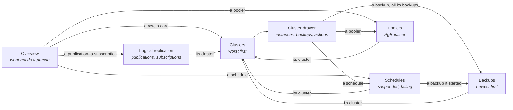
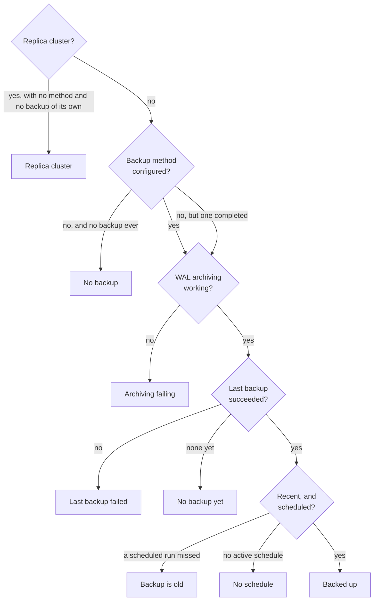

# CloudNativePG extension

Shows which Postgres clusters run by [CloudNativePG](https://cloudnative-pg.io/) need attention,
and whether each one can be restored from its backups. A cluster can be up while its WAL archive
has been failing for days; this extension puts the two side by side.

## Contents

- [Pages](#pages)
- [Can it be restored?](#can-it-be-restored)
- [Features](#features)
- [Actions](#actions)
- [What it will not do](#what-it-will-not-do)

## Pages

| Rule | Detail |
|------|--------|
| Shown only with its CRD | The group appears where `clusters.postgresql.cnpg.io` exists |
| Namespaces | Every page has the host's namespace selector |
| Loading is not empty | A page draws no row until its lists are read, and says when one could not be |
| Refused namespaces | Left out and named, and asked again; the rest of the page still shows |
| Cards and filters | A card opens its list on a chip that keeps exactly the rows it counts |
| Links | An object opens its own drawer; pods, nodes, volumes and Secrets open the host's list |
| Instance status | Read a few at a time, each with a time limit, not while the window is hidden |
| Long Backups list | Only the first rows are drawn; search and sort still run over every Backup |

## Can it be restored?

| Topic | How it reads |
|-------|--------------|
| Sources | The Barman Cloud plugin's `ObjectStore`, the in-tree `barmanObjectStore`, and volume snapshots |
| Replica cluster | Restored from its source's backups; its `-rw` URL is marked read-only and its primary is the designated primary |
| Old backup | The most frequent active schedule missed a run, with a grace; without one, older than about a day |
| Failure cause | The operator keeps only an exit status, so barman's error is read from the instance's log |
| Hibernated | Its phase says healthy; the extension reads the hibernation annotation instead |

## Features

| Page | Features |
|------|----------|
| Overview | Cards for every cluster, not ready, cannot be restored safely, no backup, hibernated and poolers down. A list of what needs attention, worst first, each row opening its drawer |
| Overview, attention | Also expiring certificates, broken volumes, roles and tablespaces not applied, replicas lagging or not streaming, failing schedules, publications or subscriptions not applied |
| Clusters | State, ready instances, version, primary (and, for a replica cluster, the cluster it replays, also found by search), certificate issuer, worst replica lag, backup state and last backup; filter chips per card |
| Cluster drawer, status | Primary or designated primary, the source a replica cluster replays and its host, last switchover, recovery window, WAL position, uptime and database sizes from the metrics exporter, connection URLs to copy without the password |
| Cluster drawer, instances | Primary first, then replicas, each with node, timeline, lag and a pending restart; replication slots |
| Cluster drawer, health | Roles and tablespaces not applied, disruption budgets, node maintenance window, unhealthy volumes, certificates and when they expire, recent warning events |
| Cluster drawer, more | Every instance's postgres log in one list, recent backups, schedules and poolers, commands to copy |
| Backups | State, error when it failed, cluster, Postgres major version, method, duration and age; the drawer links the cluster, schedule and pod |
| Schedules | Active, suspended, last run failed or missing its cluster; when it runs, in words with the cron. The drawer lists the backups it started |
| Poolers | Active, paused, degraded, no ready pod, or in front of a missing or stopped cluster. The drawer shows pool mode, service and PgBouncer parameters |
| Logical replication | Every Publication and Subscription, applied or the operator's reason; the drawer shows what it carries and its reclaim policy |

Replica states, shown in the instance list, the clusters list's lag and the overview:

| State | Meaning |
|-------|---------|
| Not streaming | The primary reports no streaming connection from it |
| Replay paused | Paused by hand |
| Lagging | Far behind the primary |

## Actions

Every write asks first. While a cluster is hibernated, every write to it is refused except Wake.

| Where | Actions |
|-------|---------|
| Cluster drawer title bar | Back up now, Reload, Switch over, Hibernate or Wake, Restart, psql |
| Instances section | Restart replicas; per instance: psql, Log, Restart, Destroy |
| Node maintenance section | Start or end the window |
| Each row's menu and its drawer's title bar | Schedule, pooler, backup, publication and subscription actions |
| Ticked rows | Clusters, backups, schedules, poolers and logical replication; each lists the rows it skips and why, and asks you to type `confirm` |

| Action | Note |
|--------|------|
| Back up now | As `kubectl cnpg backup`: the cluster's method or a volume snapshot. Refused with no method |
| Reload | Re-reads configuration and certificates; restarts nothing |
| Switch over | Promotes a healthy replica you pick. Checked again on a fresh read before writing |
| Hibernate, Wake | Stops the cluster and keeps its volumes, or brings it back. Undo does the other |
| Restart | Rolling restart, replicas first, then a switchover |
| Restart replicas | Deletes each replica's pod in turn and waits for it to be Ready. Stops if a replica became the primary |
| Restart an instance | The primary restarts in place; a replica's pod is recreated |
| Destroy an instance | As `kubectl cnpg destroy`: pod, jobs and volumes. Refused for the primary and a single instance |
| Node maintenance window | As `kubectl cnpg maintenance`; choose to wait for the volume or rebuild elsewhere |
| psql | A terminal tab as `kubectl cnpg psql`. Refused with no primary or on an unhealthy instance |
| Delete a backup | Removes the Backup object; its files stay until the retention policy removes them |
| Schedule actions | Back up now, Suspend, Start, Delete. Delete takes the Backups it owns, not their files |
| Pooler actions | Pause holds new queries and keeps connections; Start, Delete |
| Delete a publication or subscription | Postgres keeps it unless its reclaim policy is delete |
| Copy commands | `kubectl cnpg status`, `psql`, the operator's log, events |

Destructive actions ask for the object's name.

## What it will not do

- Restore. A restore creates a new cluster from a backup, so it is a manifest to review.
- Delete clusters or volumes.
