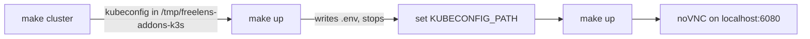

# Development

Everything runs in Docker. The host needs Docker, and `jq` for `make check` and
`scripts/security/scan.sh`.

## Contents

- [First run](#first-run)
- [The loop](#the-loop)
- [Adding an extension](#adding-an-extension)
- [Linking to a Kubernetes object](#linking-to-a-kubernetes-object)
- [When the extension does not appear](#when-the-extension-does-not-appear)
- [Reading logs](#reading-logs)
- [Checks before pushing](#checks-before-pushing)
- [Commands](#commands)

## First run



| Step | Note |
|------|------|
| `make cluster` | Disposable k3s with every tool and its samples; see [dev/cluster/README.md](../dev/cluster/README.md) |
| First `make up` | Writes `.env` with your UID and GID, then stops. `.env` is git-ignored |
| `KUBECONFIG_PATH` | Point it at the kubeconfig, or at any other cluster's. It is mounted read-only |
| Second `make up` | Builds every extension and starts Freelens at `http://localhost:6080/vnc.html?autoconnect=1&resize=scale` |
| In Freelens | Pick "All Namespaces": Freelens starts scoped to `default` on every launch |

## The loop

| Rule | Why |
|------|-----|
| Run `make up` after every change | Freelens caches the bundle; `make up` restarts it. A rebuild or window reload is not enough |
| Reload the browser tab after it | The restart drops the noVNC session |
| Connect to a cluster first | Extension pages are per cluster, in the left sidebar |

## Adding an extension

Start from the `freelens-extension` skill in `.claude/skills/`, never by copying a package. It
scaffolds the package, tests, fixtures, docs page and e2e suite. Every directory under `packages/`
must be an extension; shared code goes in `build/`.

| Part | Rule |
|------|------|
| `package.json` | `main` and `renderer` point at `out/`; the scripts match the other packages' (`test:e2e-writes` only with writes) |
| `version` | The one every other package carries, or the [release](distribution.md#cutting-a-release) refuses |
| `files: ["out"]` | Required: without it the tarball ships no renderer. `verify-bundles.sh` fails on it |
| `engines.freelens` | Gates compatibility with the running Freelens |
| Dependencies | `devDependencies` only; `@freelensapp/extensions`, `react` and `mobx` are host globals. Importing an npm library fails the build ([security](security.md#vulnerabilities)) |
| `electron.vite.config.ts` | `export default defineExtensionConfig();` from `../../build/vite/extension-config` |
| `src/main/index.ts`, `src/renderer/index.tsx` | Each default-exports a class extending `Main.LensExtension` or `Renderer.LensExtension` |

Then:

1. Run `pnpm install --fix-lockfile` in the container
   (`dc run --rm --no-deps --entrypoint sh -w /workspace freelens -lc "pnpm install --fix-lockfile"`).
   A plain install leaves the peers unresolved and `tsc` reports a wrong `override` on every member.
2. Add its component under `dev/cluster/components/<name>/`, in `COMPONENTS` and `NEEDS` in
   `dev/cluster/cluster.sh` ([dev/cluster/README.md](../dev/cluster/README.md)).
3. Add its leg to the `e2e` matrix in `.github/workflows/ci.yaml`.
4. Run `make up`, then `make check`.
5. Run its leg alone: `make ci-local JOB=e2e LEG=<name>` ([testing](testing.md#in-ci)).

## Linking to a Kubernetes object

| Need | Use |
|------|-----|
| A host object from a page | `` Renderer.Navigation.navigate(`/pods?search=<name>`) ``, name URI-encoded: every host list reads `?search=` |
| A host object from a drawer | The template's `HostLink` (`drawer-link.tsx`, `api/shared/host-links.ts`): closes the drawer, then navigates |
| One of our own lists | Add a query param and filter on it, as `name` on argocd's Applications page |
| An `href` | `getDetailsUrl`. Never pass it to `showDetails`, which expects a selfLink |

`Navigation.showDetails` does nothing from an extension's `clusterPage`: only pages that mount the
details drawer render it.

## When the extension does not appear

Check in this order.

| Symptom | Cause |
|---------|-------|
| Nothing in the logs | No `package.json`, or not directly under `packages/` |
| `can't load main` … `Cannot find module` | Not built. Run `make up` |
| `Cannot find module '@freelensapp/extensions'` | The bundle externalised it without mapping it to the host global |
| Listed, never activated, no error | `.default` is not a class; the bundle should end in `exports.default =` |
| Listed as incompatible | `engines.freelens` does not match the running version |
| Page missing from the sidebar | Connect to a cluster first |
| Connected, group still missing | The cluster lacks the CRDs in `src/renderer/api/shared/installed.ts`, or you cannot list CRDs |
| Group at the bottom of the sidebar | `clusterPageMenuOrder` in `lens-user-store.json` wins; drag it, or edit it with Freelens stopped |

## Reading logs

`dc logs -f freelens` (see [Commands](#commands)). Look for `[EXTENSIONS-LOADER]` and
`[EXTENSION-DISCOVERY]`. The main half logs there; the renderer half's `console.log` goes to the
devtools inside the app.

## Checks before pushing

Run `make check` and `bash scripts/security/scan.sh`
([security](security.md#running-the-checks-locally)). Dependency rules, the 15-day floor and
lifecycle scripts: [security](security.md#dependency-age-floor).

| Failure | What to do |
|---------|------------|
| `verify-bundles.sh` | The bundle would not load, or carries more than the extension's own `src/` |
| `freelens-first-party-only` (build) | Remove the npm import; see [security](security.md#vulnerabilities) |
| `osv-direct.sh` | Malware or a vulnerability in a version chosen here; see [security](security.md#vulnerabilities) |
| `copy-design-standard.sh --check` | Edit the standard's `design.css` in the skill templates, then run `bash scripts/checks/copy-design-standard.sh` |
| `e2e-legs.sh` | `packages/`, the `NEEDS` entries and the CI legs do not name the same extensions |
| Coverage | Add a case for the new branch; never lower the threshold ([testing](testing.md)) |
| `verify-supply-chain.sh` | A supply-chain control was weakened. Fix the cause |

## Commands

The compose file is in `dev/`, so raw compose commands need:

```bash
alias dc='docker compose -f dev/docker-compose.yml --project-directory .'
```

| Command | What it does |
|---------|--------------|
| `make up` | Build the extensions, then start or restart Freelens |
| `make down` | Stop the containers, keeping Freelens' saved state |
| `make check` | CI's first four jobs: dependency gate, lint, typecheck, unit tests with coverage, build, policy checks |
| `make deps-refresh` | Resolve the lockfile again within the ranges and the floor; monthly, and the fix for a transitive advisory |
| `make cluster`, `make cluster-down` | The dev k3s; see [dev/cluster/README.md](../dev/cluster/README.md) |
| `make kubectl ARGS="..."` | kubectl on the dev k3s, refused on any other cluster |
| `make e2e`, `make e2e-writes` | End-to-end suites and real writes; see [testing](testing.md#commands) |
| `make ci-local` | The CI workflow through act, beside the dev setup; `JOB=` and `LEG=` narrow it |
| `bash scripts/security/scan.sh` | Secret, dependency and Dockerfile scanners |
| `dc logs -f freelens` | Follow the Freelens logs |
| `dc down -v` | Stop everything and discard Freelens' saved state |
| `dc run --rm --no-deps --entrypoint sh -w /workspace freelens -lc "pnpm run lint:fix"` | Apply Biome's safe fixes |
