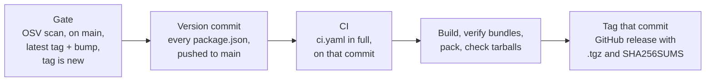

# Distribution

Each extension ships as a `.tgz` on a GitHub release and installs by file path. Nothing goes to a
registry.

## Contents

- [Compatibility](#compatibility)
- [What ships](#what-ships)
- [Installing a release](#installing-a-release)
- [Enabling an extension](#enabling-an-extension)
- [Cutting a release](#cutting-a-release)
- [Why not a registry](#why-not-a-registry)

## Compatibility

Tested on the versions the dev cluster installs and the e2e suites drive.

| Component | Tested | Note |
|-----------|--------|------|
| Freelens | 1.10.3 | `engines.freelens: ^1.10.3`: any 1.x from 1.10 installs, 2.x is refused |
| Kubernetes | k3s v1.36.4 | |
| ArgoCD | v3.5.2 | |
| Argo CD Image Updater | v1.3.0 | Needs v1.0 or later (the `ImageUpdater` CRD) |
| Trivy operator | v0.34.0 | |
| cert-manager | v1.21.2 | |
| CloudNativePG | 1.30.0 | |
| Barman Cloud plugin | v0.15.0 | Optional |
| MongoDB Controllers for Kubernetes (Community) | 1.12.0 | |
| redis-operator (OT-Container-Kit) | v0.26.0 | |
| OpenTelemetry Operator | v0.158.0 | |
| Prometheus Operator | v0.93.1 | |

## What ships

| In the tarball | What it is |
|----------------|------------|
| `package/package.json` | Entrypoints and `engines.freelens` |
| `package/out/main/index.js` | Main-process bundle and sourcemap |
| `package/out/renderer/index.js` | Renderer bundle and sourcemap |
| `package/LICENSE` | Apache 2.0; `pnpm pack` adds the root `LICENSE` to a package that has none |

No sources and no `dependencies`: the extension API, React and MobX come from the host. Every
manifest declares `"files": ["out"]`, or npm would leave out the `renderer` bundle.

Build the tarballs into `dist/`:

```bash
docker compose -f dev/docker-compose.yml --project-directory . \
  run --rm --no-deps --entrypoint sh -w /workspace freelens \
  -lc "pnpm run -r build && bash scripts/release/package-extensions.sh"
```

## Installing a release

1. Download the `.tgz` and `SHA256SUMS`; check with `sha256sum -c SHA256SUMS`.
2. In Freelens, open File > Extensions (`Ctrl+Shift+E`, `Cmd+Shift+E` on macOS).
3. Give it the file path and press Install, or drag the file there.
4. It is listed as Disabled: [enable it](#enabling-an-extension).

Without the window, extract it into `~/.freelens/extensions/<name>/`. Freelens picks it up, disabled:

```bash
mkdir -p ~/.freelens/extensions/freelens-addons-argocd
tar xzf freelens-addons-argocd-<version>.tgz --strip-components=1 \
  -C ~/.freelens/extensions/freelens-addons-argocd
```

To remove one, choose Uninstall in its `⋮` menu, or delete its folder.

## Enabling an extension

A new extension starts disabled, and disabled looks the same as failed to load.

1. In File > Extensions, find `@freelens-addons/<name>`.
2. Open its `⋮` menu and choose Enable. No restart needed.
3. Open a cluster and pick "All Namespaces" in any list. Freelens opens scoped to one namespace.

The group then appears in the cluster's sidebar.

| Group missing? | Cause and fix |
|----------------|---------------|
| Not listed on the Extensions page | Not installed. Retry, and read `EXTENSION-INSTALLER` in `~/.config/Freelens/logs/lens.log` |
| Listed as Disabled | Enable it |
| Missing on one cluster only | That cluster lacks the tool's CRDs. Check with `kubectl get crd` |
| CRDs present, still missing | You cannot list CRDs: `kubectl auth can-i list customresourcedefinitions` |
| Group there, pages empty | The namespace scope, step 3 |

## Cutting a release

Run **Release** from the Actions tab and pick `patch`, `minor` or `major`, or:

```bash
gh workflow run release.yaml --ref main -f bump=minor
```

| Bump | When | From 0.6.0 |
|------|------|------------|
| `patch` | Fixes only | 0.6.1 |
| `minor` | New features; nothing users rely on changes | 0.7.0 |
| `major` | Something users relied on changes or goes away | 1.0.0 |

Nobody edits a version or pushes a tag by hand.



| Step | Why |
|------|-----|
| Gate | Same dependency scan as CI ([security](security.md#vulnerabilities)). Next version from the latest `vX.Y.Z` tag (none: `v0.0.0`); refuses an existing tag |
| Version commit | `chore(release): X.Y.Z` by `github-actions[bot]`; only the version lines change. Already at that version (a retry): no commit. Refused if `main` moved since the run began |
| CI, build, tag | All on the version commit, so the tag holds what was tested |
| Install with the lockfile | Re-checks the 15-day age floor |
| `verify-bundles.sh` | The loader contract, and no code from outside each extension's `src/` |
| Check tarballs | Both entrypoints, the manifest and `LICENSE` are inside |

| Job | Token |
|-----|-------|
| Gate, CI | `contents: read` |
| Version commit, tag and publish | `contents: write` |

A failed release leaves no tag: start a new run with the same `bump`. A push made by the workflow
starts no other workflow.

## Why not a registry

Every manifest keeps `"private": true`, so `npm publish` fails; `pnpm pack` still works.

| Registry | Why not |
|----------|---------|
| Any authenticated one | Freelens sends no token when it fetches from a registry |
| GitHub Packages | Needs a token even for public reads |
| npmjs | Would work. Not chosen: release tarballs are enough |
