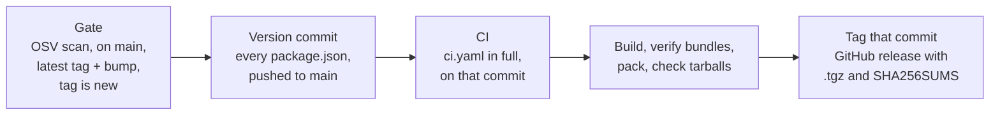

# Distribution

Each extension ships as a `.tgz` on a GitHub release and installs by file path. Nothing goes to a
registry.

## Contents

- [Compatibility](#compatibility)
- [What ships](#what-ships)
- [Installing a release](#installing-a-release)
- [Enabling an extension](#enabling-an-extension)
- [Cutting a release](#cutting-a-release)
- [Why not a registry](#why-not-a-registry)

## Compatibility

Tested on the versions the dev cluster installs and the e2e suites drive.

| Component | Tested | Note |
|-----------|--------|------|
| Freelens | 2.0.0 | `engines.freelens: ^2.0.0`: any 2.x loads it. Tarballs up to 0.6.0 are for 1.10 |
| Kubernetes | k3s v1.36.4 | |
| ArgoCD | v3.5.2 | |
| Argo CD Image Updater | v1.3.0 | Needs v1.0 or later (the `ImageUpdater` CRD) |
| Trivy operator | v0.34.0 | |
| cert-manager | v1.21.2 | |
| CloudNativePG | 1.30.0 | |
| Barman Cloud plugin | v0.15.0 | Optional |
| MongoDB Controllers for Kubernetes (Community) | 1.12.0 | |
| redis-operator (OT-Container-Kit) | v0.26.0 | |
| OpenTelemetry Operator | v0.158.0 | |
| Prometheus Operator | v0.93.1 | |

## What ships

A tarball holds `package.json`, the two bundles under `out/` with their sourcemaps, and `LICENSE`.
No sources and no `dependencies`: the extension API, React and MobX come from the host.

Build the tarballs into `dist/`:

```bash
docker compose -f dev/docker-compose.yml --project-directory . \
  run --rm --no-deps --entrypoint sh -w /workspace freelens \
  -lc "pnpm run -r build && bash scripts/release/package-extensions.sh"
```

## Installing a release

1. Download the `.tgz` and `SHA256SUMS`; check with `sha256sum -c SHA256SUMS`.
2. In Freelens, open File > Extensions (`Ctrl+Shift+E`, `Cmd+Shift+E` on macOS).
3. Give it the file path or the release asset's URL and press Install, or drag the file there.
4. It is listed as Disabled: [enable it](#enabling-an-extension).

Freelens 2 does not carry over extensions installed under 1.x: install the 2.x tarball again.

Without the window, extract it into `<userData>/extensions/<name>/` (`~/.config/Freelens` on
Linux). A running Freelens picks it up and lists it as unverified, disabled:

```bash
mkdir -p ~/.config/Freelens/extensions/freelens-addons-argocd
tar xzf freelens-addons-argocd-<version>.tgz --strip-components=1 \
  -C ~/.config/Freelens/extensions/freelens-addons-argocd
```

To remove one, choose Uninstall in its `⋮` menu, or delete its folder.

## Enabling an extension

A new extension starts disabled, and disabled looks the same as failed to load.

1. In File > Extensions, find `@freelens-addons/<name>`.
2. Open its `⋮` menu and choose Enable. No restart needed.
3. Open a cluster and pick "All Namespaces" in any list. Freelens opens scoped to one namespace.

The group then appears in the cluster's sidebar.

| Group missing? | Cause and fix |
|----------------|---------------|
| Not listed on the Extensions page | Not installed. Retry, and read `EXTENSION-INSTALLER` in `~/.config/Freelens/logs/lens.log` |
| Not listed after a manual extract | `package.json` is not directly in `<userData>/extensions/<name>/` |
| Listed as incompatible | A tarball for Freelens 1.x (0.6.0 or older) |
| Listed as Disabled | Enable it |
| Missing on one cluster only | That cluster lacks the tool's CRDs. Check with `kubectl get crd` |
| CRDs present, still missing | You cannot list CRDs: `kubectl auth can-i list customresourcedefinitions` |
| Group there, pages empty | The namespace scope, step 3 |

## Cutting a release

Run the Release workflow from the Actions tab and pick `patch`, `minor` or `major`, or:

```bash
gh workflow run release.yaml --ref main -f bump=minor
```

| Bump | When | From 0.6.0 |
|------|------|------------|
| `patch` | Fixes only | 0.6.1 |
| `minor` | New features; nothing users rely on changes | 0.7.0 |
| `major` | Something users relied on changes or goes away | 1.0.0 |

Nobody edits a version or pushes a tag by hand.



- The gate runs the same dependency scan as CI and refuses a tag that exists.
- The version commit is `chore(release): X.Y.Z` by `github-actions[bot]`; only version lines change.
- CI, the build and the tag all use that commit, so the tag holds what was tested.
- The tarballs are checked before publishing: both entrypoints, the manifest and `LICENSE`.

A failed release leaves no tag: start a new run with the same `bump`. A push made by the workflow
starts no other workflow.

## Why not a registry

Every manifest keeps `"private": true`, so `npm publish` fails; `pnpm pack` still works.

Freelens sends no token when it fetches from a registry, and GitHub Packages needs one even for
public reads. npmjs would work; release tarballs are enough.
