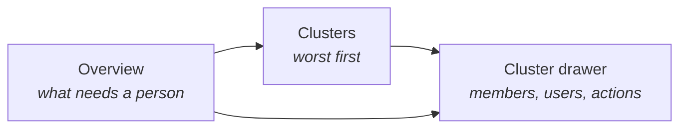
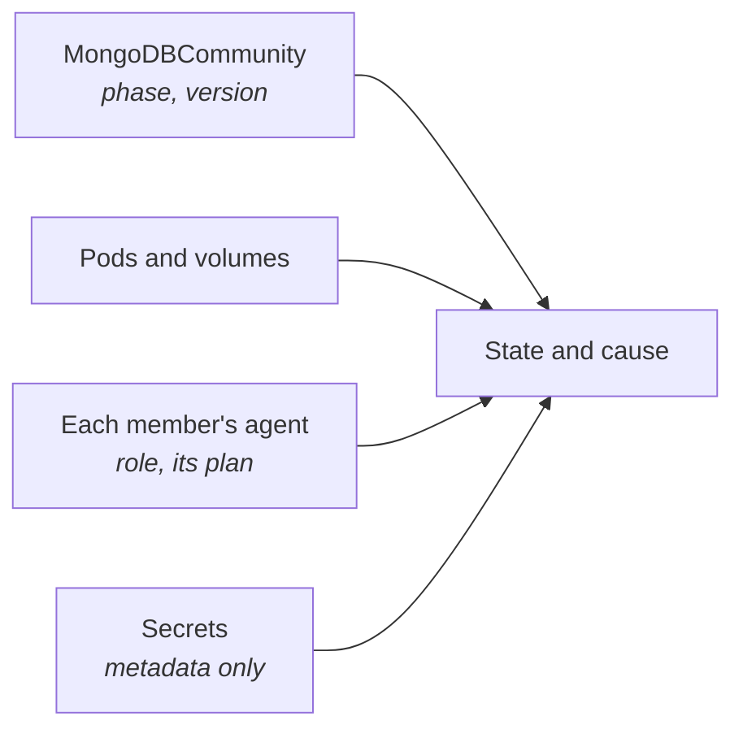

# MongoDB extension

Shows which MongoDB clusters (replica sets) run by [MongoDB Controllers for Kubernetes](https://github.com/mongodb/mongodb-kubernetes)
(MCK, Community mode) need attention, which member is primary, and why one is stuck. The operator
reports a stuck cluster as "not yet ready, retrying"; the cause is in a pod, a volume or the
automation agent, and this extension puts it beside the cluster.

## Contents

- [Pages](#pages)
- [Where the answers come from](#where-the-answers-come-from)
- [Features](#features)
- [Actions](#actions)
- [What it will not do](#what-it-will-not-do)

## Pages

The group appears only where the `mongodbcommunity.mongodbcommunity.mongodb.com` CRD exists.

## Where the answers come from

The status names no primary. Each member's agent writes its role to a file in its pod, and the
extension reads it as `kubectl exec` does, so it needs `pods/exec`. Without it the members show no
role and a banner says why. What could not be read shows as unknown, never as down or missing.

## Features

| Page | Shows |
|------|-------|
| Overview | Cards per state, and what needs attention, worst first, each with its cause |
| Clusters | State and cause, ready members, primary, TLS and its issuer, version |
| Cluster drawer | Status and connection URL, each member's role, node, volume and cause, users, recent warnings, commands to copy |

## Actions

Every write asks first. Destructive ones ask for the object's name.

| Action | Note |
|--------|------|
| mongosh | A terminal tab on the primary or a member. The password is read in the shell, never by Freelens |
| Switch primary | Raises a ready secondary's priority. Refused unless the set is running |
| Scale | Changes the data members; the dialog warns as you type. Undo restores the count |
| Restart all | Secondaries and arbiters one at a time, then the primary. Refused unless every member is ready |
| Restart a member | Deletes its pod. Refused when the rest would lose the majority |
| Logs | A member's mongod or agent log |
| Delete | Removes the cluster; its volumes are kept |

## What it will not do

- Back up or restore. MCK Community has neither.
- Create users or change passwords.
- Change the MongoDB version. Upgrades are left to git.
