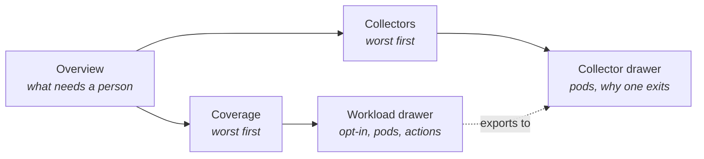
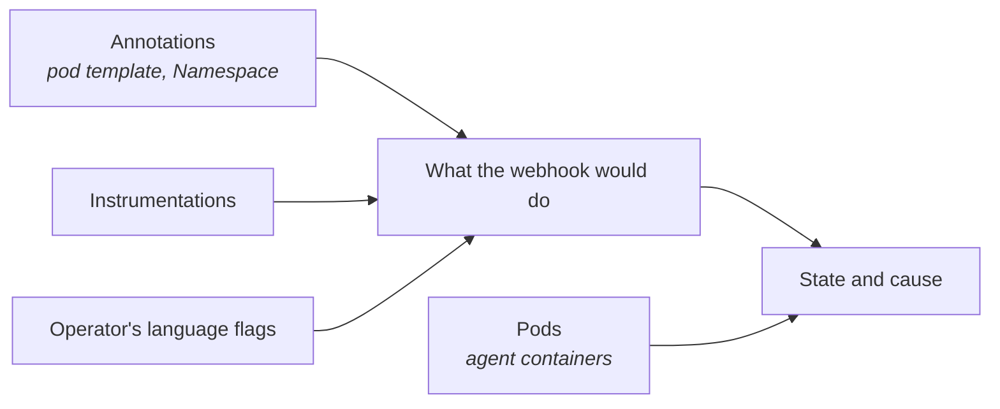

# OpenTelemetry extension

Shows which workloads opted in to auto-instrumentation by the
[OpenTelemetry Operator](https://github.com/open-telemetry/opentelemetry-operator) run without the
agent and why, and which collectors crash and why. The operator's webhook admits such a pod without
the agent and says so only in its own log; the extension works that decision out again and puts the
cause beside each workload.

## Contents

- [Pages](#pages)
- [Where the answers come from](#where-the-answers-come-from)
- [Features](#features)
- [Actions](#actions)
- [What it will not do](#what-it-will-not-do)

## Pages

The group appears only where an Instrumentation or OpenTelemetryCollector CRD exists.
Instrumentations and collectors are read in every namespace, since an annotation can name one in
another.

## Where the answers come from

| Fact | Source |
|------|--------|
| Opted in | The `inject-<language>` annotations, with the operator's precedence |
| Injected | The markers the operator itself checks: the agent init container, the Go sidecar or the SDK's variable |
| A collector ready | Its pods, not its `Ready` condition, which stays true while it crash loops |
| Why a collector exits | The `Error:` or `panic:` line of the previous run's log, or `OOMKilled` |

## Features

| Page | Shows |
|------|-------|
| Overview | Workloads that need a restart, not injected, injected and opted out; collectors not ready; what needs attention |
| Coverage | One row per opted-in workload: language, Instrumentation, pods with the agent, state and reason |
| Collectors | Mode, ready pods, version, target allocator, state and cause |
| Drawers | Where the opt-in comes from and the collector it exports to; a collector's pods with restarts and last exit code |

## Actions

Every write asks first.

| Action | Note |
|--------|------|
| Restart | Rolls the pods so the webhook injects the new ones. Only where it would help; never a CronJob or Job |
| Restart ticked rows | The same in bulk; lists the rest as skipped |
| Copy annotation YAML | The pod-template annotation to commit to Git |
| Log | A collector or target allocator pod's log |

## What it will not do

- Write the annotations: a Git sync would revert them.
- Read Secrets; a TLS Secret is checked by name only.
- Show the target allocator's targets.
