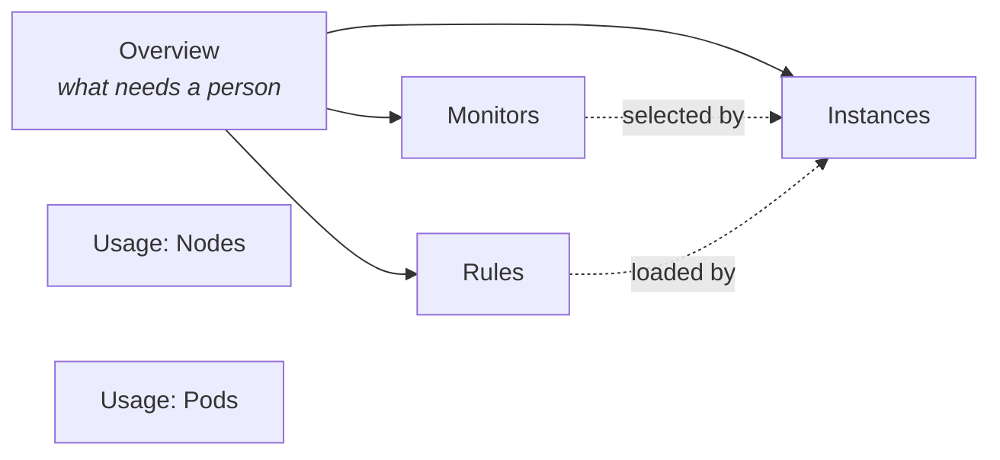
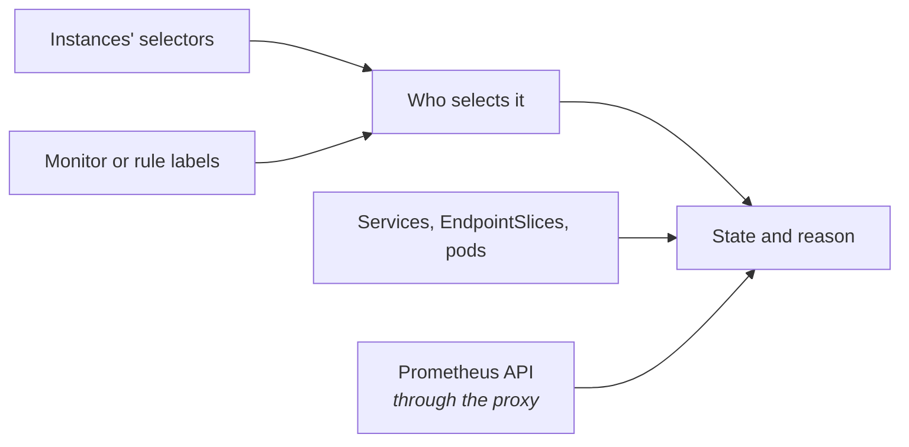

# Prometheus extension

Shows whether each ServiceMonitor, PodMonitor, ScrapeConfig and PrometheusRule of the
[Prometheus Operator](https://github.com/prometheus-operator/prometheus-operator) is picked up and
working, and how nodes and pods use their resources. A monitor no Prometheus selects, or one whose
selector or port finds nothing, is ignored in silence: no status, no target. The extension works out
who selects each object, checks what it points at, and asks the selecting Prometheus what it scrapes
and what fires.

## Contents

- [Pages](#pages)
- [Where the answers come from](#where-the-answers-come-from)
- [Usage and the cluster's metrics setting](#usage-and-the-clusters-metrics-setting)
- [Features](#features)
- [What it will not do](#what-it-will-not-do)

## Pages

The group appears only where a `monitoring.coreos.com` CRD exists. Instances are read in every
namespace, since a selector in one takes objects in others.

## Where the answers come from

| Fact | Source |
|------|--------|
| Selected by | Each instance's object and namespace selectors, with the operator's defaults |
| What it points at | The Services or pods the selector matches, and whether they carry the port |
| Rejected | The operator's `InvalidConfiguration` Events |
| Live health | `targets`, `scrape_pools` and `rules` of each selecting Prometheus |
| A rule's alerts | The loaded groups, matched to the PrometheusRule |

## Usage and the cluster's metrics setting

The Usage pages ask the Prometheus set in the cluster's Settings → Metrics.

| Source of metrics | What to set in Settings → Metrics |
|-------------------|-----------------------------------|
| Prometheus run by the operator | Nothing; auto-detect finds it |
| Another Prometheus | Its Service, port and path prefix |
| Mimir | A proxy that adds the tenant header, with its path prefix |

Node figures come from node-exporter, pod figures from the kubelet's cAdvisor. A value with no
series shows "no data", never zero.

## Features

| Page | Shows |
|------|-------|
| Overview | Monitors, rules and instances that need attention, worst first |
| Monitors | Who selects it, what it reaches, live health, state and reason. The drawer adds the targets and the fix YAML |
| Rules | Who loads it, groups, alerts firing, state |
| Instances | Prometheuses, agents and Alertmanagers: ready replicas, shards, where alerts go |
| Nodes | CPU, memory, filesystem and network per node, against capacity |
| Pods | The top ten pods, or those chosen, against limit or request |

Nothing writes. Copy fix YAML gives the labels, port or Service labels that fix a monitor or rule,
to commit in the manifest.

## What it will not do

- Read Secret values, or show the bearer token in the cluster's metrics setting.
- Read Probes or ThanosRulers.
- Edit monitors, rules, instances or the metrics setting.
