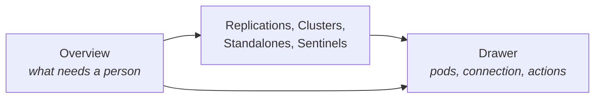

# Redis extension

Shows which objects of the [OT-Container-Kit redis-operator](https://github.com/OT-CONTAINER-KIT/redis-operator)
need attention, which pod is master, and what a failover needs. The operator records no status for a
standalone or a sentinel, so the extension judges them from their pods, volumes and events.

## Contents

- [Pages](#pages)
- [Where the answers come from](#where-the-answers-come-from)
- [Features](#features)
- [Actions](#actions)
- [What it will not do](#what-it-will-not-do)

## Pages

The group appears only where one of the operator's CRDs exists.

## Where the answers come from

| Fact | Source |
|------|--------|
| Master and replicas | The operator's `redis-role` label on each pod; it lags a failover by about half a minute |
| Writes refused | The labelled master is not ready, or no pod is labelled |
| A sentinel's state | Whether its replication exists, and ready sentinels against its quorum |
| A cluster's state | `status.state` and `status.reason` |
| Unknown | Pods or volumes not read yet, or refused; no write is judged on pods not read |

## Features

| Page | Shows |
|------|-------|
| Overview | Counts by kind and state, what needs attention, and the replications no sentinel watches |
| Lists | State and cause, ready pods, master, sentinels, TLS issuer, image tag |
| Drawer | State, master, quorum, connection URLs without the password, each pod with its role and cause, recent warnings |

## Actions

Every write asks first.

| Action | Note |
|--------|------|
| redis-cli | A terminal tab in a pod; the password stays inside the pod |
| Fail over | For a watched replication: a ready sentinel promotes a replica |
| Scale | Replications, clusters and sentinels; the dialog says what the new size removes or breaks |
| Restart a pod | Deletes it; it comes back on its volume. Refused while another pod is down |
| Restart all | Replications, standalones and sentinels, one pod at a time, the master last |
| Logs | A pod's log |

A cluster is never restarted: redis-operator v0.26.0 does not rejoin a pod back on a new IP.

## What it will not do

- Back up or restore. The operator has neither.
- Delete a Redis object or its volumes.
- Edit ACLs or change passwords.
