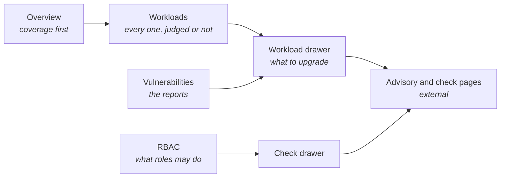
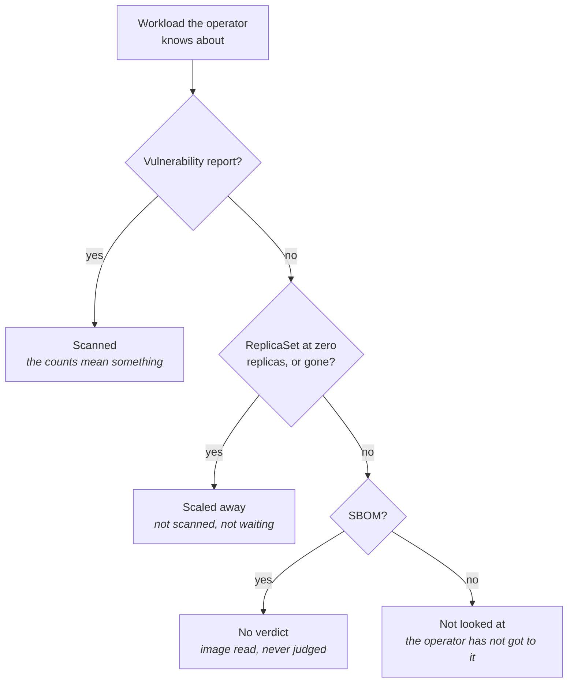

# Trivy extension

Shows whether the Trivy operator scanned each workload, then what it found. In a list of reports a
workload with no report looks the same as a clean one; this extension tells them apart. It writes
nothing to the cluster.

## Contents

- [Pages](#pages)
- [Coverage](#coverage)
- [Scan progress](#scan-progress)
- [Features](#features)

## Pages

## Coverage

A refused list is never shown as an empty one: a banner names the namespaces, and the counts leave
them out.

## Scan progress

| State | When |
|-------|------|
| working | Workloads wait for a verdict and the judged count rose recently |
| stalled | Workloads wait and the count has not risen |
| stale | All judged, but a report is older than its `report-ttl` (24 hours by default) |
| complete | All judged and fresh; no banner shows |

## Features

| Page | Shows |
|------|-------|
| Overview | Critical findings, scan progress, workloads waiting on a verdict and the most exposed ones |
| Workloads | Every workload with its coverage and counts. The drawer gives the upgrades that clear critical and high findings, failing checks and exposed secrets, never the matched text |
| Vulnerabilities | The host's list of reports; its drawer links the workload |
| RBAC | One row per failing check, with the fix and each role that fails it |
