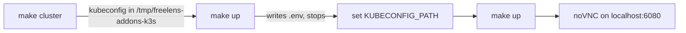

# Development

Everything runs in Docker. The host needs Docker, and `jq` for `make check` and
`scripts/security/scan.sh`.

## Contents

- [First run](#first-run)
- [The loop](#the-loop)
- [Adding an extension](#adding-an-extension)
- [When the extension does not appear](#when-the-extension-does-not-appear)
- [Checks before pushing](#checks-before-pushing)
- [Commands](#commands)

## First run



- `make cluster` is optional: any kubeconfig works, and it is mounted read-only.
- Freelens opens at `http://localhost:6080/vnc.html?autoconnect=1&resize=scale`.
- Pick "All Namespaces" there. Freelens starts scoped to `default` on every launch.

## The loop

- Run `make up` after every change. A rebuild alone does not reload the mounted extensions.
- Reload the browser tab after it: the restart drops the noVNC session.
- Connect to a cluster first. Extension pages are per cluster, in the left sidebar.

## Adding an extension

Start from the `freelens-extension` skill in `.claude/skills/`, never by copying a package. It
scaffolds the package, tests, fixtures, docs page and e2e suite. Then:

1. Run `pnpm install --fix-lockfile` in the container. A plain install leaves the peers unresolved.
2. Add its component under `dev/cluster/components/<name>/`, and to `COMPONENTS` and `NEEDS` in
   `dev/cluster/cluster.sh` ([dev/cluster/README.md](../../dev/cluster/README.md)).
3. Add its leg to the `e2e` matrix in `.github/workflows/ci.yaml`.
4. Run `make up`, then `make check`.
5. Run its leg alone: `JOB=e2e LEG=<name> dev/act/run.sh` ([testing](testing.md#in-ci)).

## When the extension does not appear

Check in this order.

| Symptom | Cause |
|---------|-------|
| Nothing in the logs | No `package.json`, or not directly under `packages/` |
| `Cannot find module` or "Failed to load" | Not built, or the renderer bundle imports something. Run `make up`; `verify-bundles.sh` names the import |
| Listed, never activated, no error | The default export is not a class; the bundle should end in `export { X as default }` |
| Listed as incompatible | `engines.freelens` is not a 2.x range |
| `extension-route-registrator failed` … `observer` | A `Page` is an `observer` itself; register it as `(props) => <X {...props} />` |
| Page missing from the sidebar | Connect to a cluster first |
| Connected, group still missing | The cluster lacks the CRDs in `src/renderer/api/shared/installed.ts`, or you cannot list CRDs |
| Group at the bottom of the sidebar | `clusterPageMenuOrder` in `lens-user-store.json` wins; drag it, or edit it with Freelens stopped |

The logs are in `dc logs -f freelens` ([Commands](#commands)): look for `[EXTENSIONS-LOADER]` and
`[EXTENSION-DISCOVERY]`. The renderer's `console.log` goes to the devtools inside the app.

## Checks before pushing

Run `make check` and `bash scripts/security/scan.sh`. CI runs them again on every pull request to
`main` ([testing](testing.md#in-ci)).

| Failure | What to do |
|---------|------------|
| `verify-bundles.sh` | The bundle would not load, or carries more than the extension's own `src/` |
| `freelens-first-party-only` (build) | Remove the npm import; see [security](security.md#vulnerabilities) |
| `osv-direct.sh` | Malware or a vulnerability in a version chosen here; see [security](security.md#vulnerabilities) |
| `copy-design-standard.sh --check` | Edit the standard's `design.css` in the skill templates, then run `bash scripts/checks/copy-design-standard.sh` |
| `e2e-legs.sh` | `packages/`, the `NEEDS` entries and the CI legs do not name the same extensions |
| `page-registrations.sh` | A `Page` is a bare component or an `observer`, so it never mounts; write `Page: (props: Common.Types.PageComponentProps) => <X {...props} />` |
| Coverage | Add a case for the new branch; never lower the threshold ([testing](testing.md)) |
| `verify-supply-chain.sh` | A supply-chain control was weakened. Fix the cause |

## Commands

The compose file is in `dev/`, so raw compose commands need:

```bash
alias dc='docker compose -f dev/docker-compose.yml --project-directory .'
```

| Command | What it does |
|---------|--------------|
| `make up` | Build the extensions, then start or restart Freelens |
| `make check` | CI's first four jobs: dependency gate, lint, typecheck, unit tests with coverage, build, policy checks |
| `bash scripts/deps-refresh.sh` | Resolve the lockfile again within the ranges and the floor; monthly, and the fix for a transitive advisory |
| `make cluster`, `make cluster-down` | The dev k3s; see [dev/cluster/README.md](../../dev/cluster/README.md) |
| MCP server `k3s-dev` | How the agent reads the dev k3s, read-only; see [kubernetes-mcp](kubernetes-mcp.md) |
| `make e2e`, `make e2e-writes` | End-to-end suites and real writes; see [testing](testing.md#commands) |
| `dev/act/run.sh` | The CI workflow through act, beside the dev setup; `JOB=` and `LEG=` narrow it |
| `bash scripts/security/scan.sh` | Secret, dependency and Dockerfile scanners |
| `dc down` | Stop the containers, keeping Freelens' saved state |
| `dc logs -f freelens` | Follow the Freelens logs |
| `dc down -v` | Stop everything and discard Freelens' saved state |
| `dc run --rm --no-deps --entrypoint sh -w /workspace freelens -lc "pnpm run lint:fix"` | Apply Biome's safe fixes |
