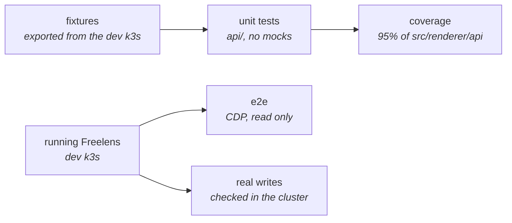
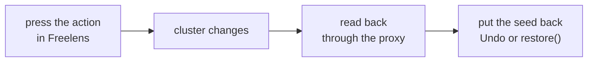
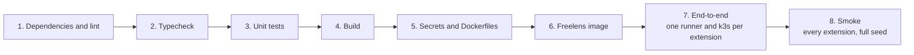

# Testing

## Contents

- [Layers](#layers)
- [Commands](#commands)
- [Unit tests](#unit-tests)
- [End-to-end](#end-to-end)
- [Real writes](#real-writes)
- [In CI](#in-ci)
- [Fixtures](#fixtures)
- [Rules](#rules)

## Layers



Unit tests run in `make check`; the other two need a running Freelens and the dev k3s. CI runs all
three.

## Commands

The cluster commands are in [development](development.md#commands).

| Command | Runs |
|---------|------|
| `make check` | Unit tests with coverage, among CI's first jobs |
| `make e2e` | Every package's suites, one package at a time; a failure does not stop the next |
| `make e2e PACKAGE=cnpg` | One package's suites; `make cluster PACKAGE=cnpg` gives it the cluster its CI leg has |
| `make e2e PACKAGE=cnpg FILES=clusters/` | Only the files whose path matches: a file (`layout`) or a folder |
| `make e2e-writes [PACKAGE=cnpg]` | Real writes; a package without any is skipped |

## Unit tests

- **No mocks.** `@freelensapp/extensions` resolves to `test/support/freelens-host.ts`, which hands
  out the real `KubeObject` and `KubeApi`. They come from `@freelensapp/kube-object` and `kube-api`
  1.10.3, test-only: Freelens 2 no longer publishes them. `tsc` checks against the v2 declarations.
- **Layout.** `test/` mirrors `src/renderer/api/`. `test/support/` holds the helpers,
  `test/fixtures/` the export.
- **Coverage.** 95% of `src/renderer/api/`, and of main modules that decide. Modules that only
  declare, register or send are excluded; the list is in each package's `vitest.config.ts`.
- **A case** starts from a real fixture and changes only the field under test (`variantOf`).
- **React pages** are covered by the e2e suites.

## End-to-end

`make e2e` restarts Freelens with a loopback debugging port and drives it over the Chrome DevTools
Protocol. Freelens loads every extension; `PACKAGE` and `FILES` narrow only the suites.

| Path | Holds |
|------|-------|
| `build/e2e/` | The protocol client, the page helpers, the design measurements and the write helpers |
| `packages/<name>/e2e/` | The suites: `shared/` for every page, then one folder per page, `selection/` and `writes/` |

Read-only suites press a write up to its confirmation and cancel.

## Real writes

`make e2e-writes` runs each package's `e2e/writes/*.writes.ts`. Each write goes through the UI, as
a person would; the test then reads the result from the cluster.



| Rule | Why |
|------|-----|
| Only the dev k3s | `openWorkbench` refuses any other cluster |
| Each test leaves the seed as it found it | Undo where there is one, else `restore()`, registered with `putBackWith` so it runs however the test ends |
| A delete only for an object the test can recreate as seeded | CloudNativePG's Subscription is the one case |

Each extension's page lists its writes; Trivy and Prometheus have none. CloudNativePG's
volume-snapshot backups have unit tests only: the dev k3s has no VolumeSnapshotClass.

## In CI

One workflow, `.github/workflows/ci.yaml`, on pull requests to `main`, by hand, and from the release,
which runs it on its version commit before it tags ([distribution](distribution.md#cutting-a-release)).
Each job runs only if the one before passed. A new push to a pull request cancels its older run.



- **1 to 6:** checks, unit tests, build, scans and the Freelens image.
- **7:** one leg per extension: `make cluster`, `make e2e` and `make e2e-writes` with its `PACKAGE`.
  A failing leg does not cancel the others.
- **8:** every `pages-render` suite in one window on the full seed, as someone who installs them all.

`scripts/checks/e2e-legs.sh` fails unless the legs, `packages/` and the `NEEDS` map in
`dev/cluster/cluster.sh` name the same extensions.

`dev/act/run.sh` runs the workflow through [act](https://github.com/nektos/act) on a copy of the tree,
as another compose project, so the dev setup keeps running.

| Variable (env) | Effect |
|----------|--------|
| `JOB=lint` | One job |
| `JOB=e2e LEG=cnpg` | One leg; legs run one at a time, each from a clean setup |
| `JOB=smoke` | The smoke run |
| `KEEP=1` | Leaves the last cluster and Freelens up |

## Fixtures

```bash
dev/cluster/cluster.sh fixtures          # every package
dev/cluster/cluster.sh fixtures argocd   # one
```

| Rule | Detail |
|------|--------|
| Dev k3s, full seed | Refuses any other cluster, or one missing a component (as after `PACKAGE=`) |
| Sanitised | `dev/cluster/fixtures/sanitise.py`; read the diff before committing |
| Trivy namespaces | Only those in `TRIVY_NAMESPACES` in `export.sh`; a new Trivy case's namespace goes there |
| Prometheus | Also what each Prometheus API answers, and each TargetAllocator's job names |

The sanitiser removes what identifies the host (IPs, UUIDs, the domains in
`FIXTURE_REDACT_DOMAINS`), credentials and Secret data, and bulk such as `managedFields`. The full
list is `sanitise.py`.

## Rules

| Rule | Why |
|------|-----|
| No mocks | The real classes catch shapes a stand-in gets wrong |
| Never hand-write a fixture | Cause the state in the component's `states.sh` |
| Time-dependent code takes `now` | Tests pass the export's time, from `exported-at.json` |
| A new test fails without its fix | Check by reverting the fix |
| e2e sets up its own state | Freelens remembers sidebar groups and the namespace scope |
| No leg inherits state | Each leg seeds its own k3s and starts its own Freelens |
| Wait for a late state in `settle.sh` | Never with a longer timeout in a test |
| Prometheus pages mark `data-live="read"` | Suites wait on it instead of sleeping |
| e2e follows a person's order | Narrow, look, widen, look |
| Change a loading path, run every `namespace-scope` suite | The hooks share one pattern |
