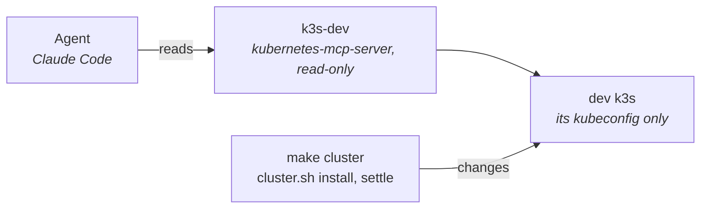

# Kubernetes MCP

## Contents

- [What it is](#what-it-is)
- [Setup](#setup)
- [What it can do](#what-it-can-do)
- [Rules](#rules)
- [Troubleshooting](#troubleshooting)

## What it is

The agent reads the dev k3s through an MCP server, `k3s-dev`, never through `kubectl`. It only
reads; the cluster changes only through `make cluster` and `dev/cluster/cluster.sh`.



| Part | Value |
|------|-------|
| Server | [kubernetes-mcp-server](https://github.com/containers/kubernetes-mcp-server), pinned version, run with `npx` |
| Cluster | The dev k3s kubeconfig, `/tmp/freelens-addons-k3s/kubeconfig.yaml`, written by `make cluster` |
| Registered in | `.mcp.json` at the repository root, local: not committed |

## Setup

1. Start the cluster: `make cluster`.
2. Create `.mcp.json` at the repository root:

```json
{
  "mcpServers": {
    "k3s-dev": {
      "type": "stdio",
      "command": "npx",
      "args": [
        "-y",
        "kubernetes-mcp-server@0.0.67",
        "--kubeconfig",
        "/tmp/freelens-addons-k3s/kubeconfig.yaml",
        "--cluster-provider",
        "kubeconfig",
        "--read-only",
        "--toolsets",
        "core,config"
      ]
    }
  }
}
```

3. Keep it out of git: `echo /.mcp.json >> .git/info/exclude`.
4. Open a new Claude Code session in the repository and approve `k3s-dev` when asked.
5. Check it: `claude mcp list` shows `k3s-dev` connected.

| Flag | Why |
|------|-----|
| `@0.0.67` | A pinned version at least 15 days old ([security](security.md#dependency-age-floor)) |
| `--kubeconfig` | The dev k3s only; never `~/.kube/config` or another cluster |
| `--cluster-provider kubeconfig` | Uses that file, no auto-detection |
| `--read-only` | Only tools that read are loaded |
| `--toolsets core,config` | The basic tools; the rest is not needed here |

## What it can do

| Tools | For |
|-------|-----|
| `pods_list`, `pods_get`, `pods_log`, `pods_top` | Pods, their logs and usage |
| `resources_list`, `resources_get` | Any kind, CRDs included |
| `events_list` | Warnings while a seed settles |
| `namespaces_list`, `nodes_*` | Namespaces and the node |
| `configuration_view` | Which cluster it points at |

## Rules

| Rule | Why |
|------|-----|
| Never ask it for Secrets | Flags cannot block them; Secret values must never reach the agent |
| Writes go through `cluster.sh` | The server is read-only; `cluster.sh` refuses any cluster but the dev k3s |
| Upgrade only past the age floor | Same rule as every dependency |

## Troubleshooting

| Symptom | Cause |
|---------|-------|
| `k3s-dev` not listed | Not approved yet, or `.mcp.json` not at the repository root |
| Connected, every call fails | The k3s is stopped: `make cluster` |
| Old resources after `make cluster-down` | The kubeconfig changed: restart the session |
