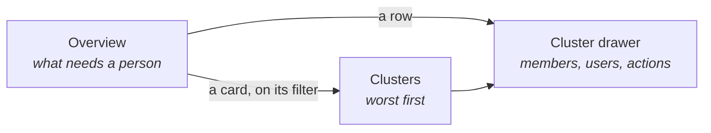
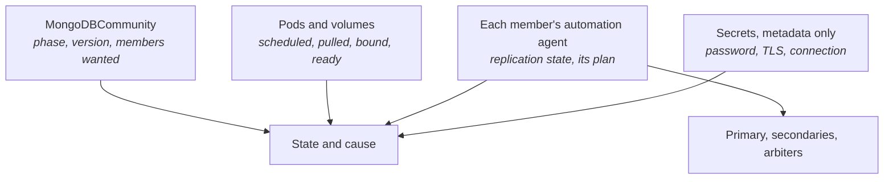

# MongoDB extension

Shows which MongoDB clusters (replica sets) run by [MongoDB Controllers for Kubernetes](https://github.com/mongodb/mongodb-kubernetes)
(MCK, Community mode) need attention, which member is primary, and why one is stuck. The operator
reports a stuck cluster as "not yet ready, retrying"; the cause is in a pod, a volume or the
automation agent, and this extension puts it beside the cluster.

## Contents

- [Pages](#pages)
- [Where the answers come from](#where-the-answers-come-from)
- [Features](#features)
- [Actions](#actions)
- [What it will not do](#what-it-will-not-do)

## Pages

The group appears only where the `mongodbcommunity.mongodbcommunity.mongodb.com` CRD exists. Every
page has the host's namespace selector. Until the clusters are read, the pages say they are
connecting, or could not read them, instead of saying there are none.

## Where the answers come from

The status names no primary. Each member's agent writes its replication state and plan to a file
in its pod; the extension reads it as `kubectl exec` does, so it needs `pods/exec`. Without it the
members show no role and a banner says why. Agents are read a few at a time, each with a time
limit. A failed step in a plan is a cause only while the member is short of its goal.

| Not read | What the cluster shows |
|----------|------------------------|
| Its pods | Members unknown, not Down |
| One agent | Its last role for a short while, then Primary unknown |
| A ready member's role, with no other primary | Primary unknown; No primary only once every role is read |
| The Secrets of a namespace | Its users and TLS are not judged; one listed before keeps what it listed |
| The events of its namespace | The drawer says so and keeps the warnings it read before |

| Topic | Rule |
|-------|------|
| Secrets | Listed as metadata only: names and cert-manager's annotations, never values |
| Version | A cluster that never ran shows its version as not reached yet |
| Missing TLS Secret | With no member up it is the cluster's cause; otherwise its own attention row. A CA in a ConfigMap is not checked |

## Features

| Page | Features |
|------|----------|
| Overview | Once the lists are read, cards for every cluster, then down, failed or no primary, degraded, changing version, missing a password Secret, missing a TLS Secret; each opens the list on its filter |
| Overview, attention | What needs attention, worst first, each with its cause; a row opens the drawer. A banner when agents cannot be read |
| Clusters | State and cause, ready members, primary, TLS and its issuer, version; filters per card with counts |
| Cluster drawer, status | Primary, version and feature compatibility, TLS Secret and CA, authentication, metrics, connection URL to copy without the password |
| Cluster drawer, members | Role, node, volume size, readiness, uptime, restarts and cause; the preferred primary, a member left from a scale-down, and the change an agent is applying |
| Cluster drawer, more | Users with roles and connection Secret; recent warning events of the set, its pods, StatefulSets and volumes; commands to copy |

## Actions

Every write asks first; the dialog closes on OK and the result comes as a notification.

| Where | Actions |
|-------|---------|
| Drawer title bar | mongosh, Switch primary, Scale, Delete |
| Members section | Restart all |
| Each member's row | mongosh, Make primary, Restart, Logs |
| Ticked rows | Restart, Delete; Restart skips clusters not running; both ask you to type `confirm` |

| Action | Note |
|--------|------|
| mongosh | A terminal tab on the primary or a member, with the first user's connection string. The password is read in the shell, never by Freelens |
| Switch primary | Raises a ready secondary's priority so it stays preferred. Refused unless the set is running and no member is applying a change |
| Scale | Changes the data members; past the seventh voter they join without a vote. The dialog warns as you type. Undo restores the count |
| Restart all | Secondaries and arbiters one at a time, then the primary. Refused unless every member is ready and the primary is read. A step not done in ten minutes stops it |
| Restart a member | Deletes its pod. Refused when the rest would lose the majority |
| Logs | A member's mongod or agent log in a log tab |
| Delete | Removes the cluster; its volumes are kept |
| Copy commands | `kubectl describe`, pods, agent logs, the operator's log, the full connection string, `rs.stepDown()` |

While Restart all runs, every other write to that cluster's members is refused. Destructive actions
ask for the object's name.

## What it will not do

- Back up or restore. MCK Community has neither; they need Ops Manager.
- Create users or change passwords. That writes credentials.
- Pause a cluster. The operator has no such state.
- Change the MongoDB version or the feature compatibility. Upgrades are left to git.
