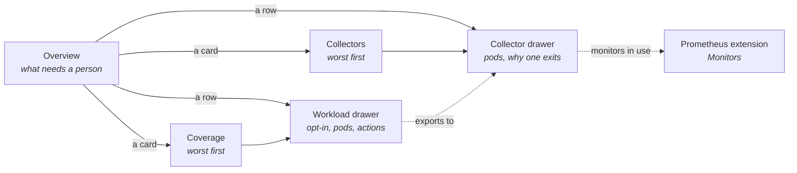
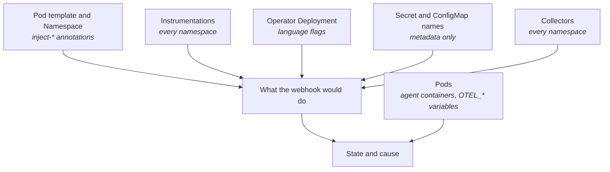

# OpenTelemetry extension

Shows which workloads opted in to auto-instrumentation by the
[OpenTelemetry Operator](https://github.com/open-telemetry/opentelemetry-operator) run without the
agent and why, and which collectors crash and why. The operator's webhook admits such a pod without
the agent and says so only in its own log; the extension works that decision out again and puts the
cause beside each workload.

## Contents

- [Pages](#pages)
- [Where the answers come from](#where-the-answers-come-from)
- [Features](#features)
- [Actions](#actions)
- [What it will not do](#what-it-will-not-do)

## Pages

The group appears only where the `instrumentations.opentelemetry.io` or
`opentelemetrycollectors.opentelemetry.io` CRD exists. Every page has the host's namespace selector;
Instrumentations and collectors are read in every namespace, since an annotation can name one in
another.

## Where the answers come from

| Fact | Source |
|------|--------|
| Opted in | The `inject-<language>` annotations on the pod template and the Namespace, with the operator's precedence. The same key on the workload itself reads Misplaced |
| The Instrumentation | `"true"` takes the only one in the namespace; a name or `namespace/name` takes that one. None, or several for `"true"`, means no agent |
| Other blockers | The operator's own checks: TLS Secret or ConfigMap in the pod's namespace, `container-names` per language (a comma-separated list, no name twice), the sidecar collector it names, Python's limits |
| Languages enabled | The operator Deployment's flags, then its variables, then its defaults. A language turned off reads Blocked; a setting it cannot read reads Unknown |
| Batch workloads | A CronJob is judged by its newest Job. Nothing restarts it: the next run gets the agent |
| Injected | The markers the operator itself checks: the agent init container, the Go sidecar, or the SDK's variable |
| A collector ready | Its pods, not its `Ready` condition, which stays true while it crash loops. A failing target allocator warns too |
| Why a collector exits | The `Error:` or `panic:` line of the previous run's log, or `OOMKilled` from the exit reason |
| Where the agent exports | The Instrumentation's endpoint matched to a collector's Service, OTLP port and pods. A collector outside the namespaces in scope is named without its health. It never changes the row's state |
| Not read yet | Rows read Checking until their inputs load, and Unknown only when a read is refused |

## Features

| Page | Features |
|------|----------|
| Overview | Cards for workloads that need a restart, not injected, injected, opted out, and collectors not ready; what needs attention, worst first, each row opening its drawer |
| Coverage | One row per opted-in workload: language, Instrumentation, pods with the agent, container, state and reason. Filtered, searched (name, namespace, kind, Instrumentation or state) and sorted |
| Collectors | Mode, ready pods, version, target allocator, state and cause. Searched (name, namespace, mode or state) and sorted |
| Workload drawer | Per language, where the opt-in comes from and what it resolves to; the Instrumentation's endpoint, sampler, propagators; the collector it exports to, linked to its drawer; each pod with its agent, linked to the host's Pods; commands to copy |
| Collector drawer | Mode, readiness, version, image, target allocator, metrics settings; links to the host's lists and to the Prometheus extension's Monitors; pods with restarts, last exit code, a Pods link and a Log button |

## Actions

Workload actions are in the drawer's title bar and each row's `⋮` menu; Log is a button on each pod
of the collector drawer. Every write asks first and reports by notification.

| Action | Note |
|--------|------|
| Restart | Rolls the pods, as `kubectl rollout restart` does, so the webhook injects the new ones. Only where a restart would help; never a CronJob or Job. Asks for the name |
| Restart (ticked rows) | Restarts each ticked workload a restart would help and lists the rest as skipped. Asks for `confirm` |
| Copy annotation YAML | The pod-template annotation to commit to Git, with the candidates when the value is ambiguous or names nothing |
| Log | A collector or target allocator pod's log in a log tab |
| Copy commands | Agents per pod, Instrumentations, the operator's log, a collector's previous log and spec |

## What it will not do

- Write the annotations: a Git sync would revert them, so the YAML to commit is copied instead.
- Read Secrets; a TLS Secret is checked by name only.
- Show the target allocator's targets, or manage the monitors a collector creates.
- Tell whether an injected pod carries an older version of its Instrumentation.
