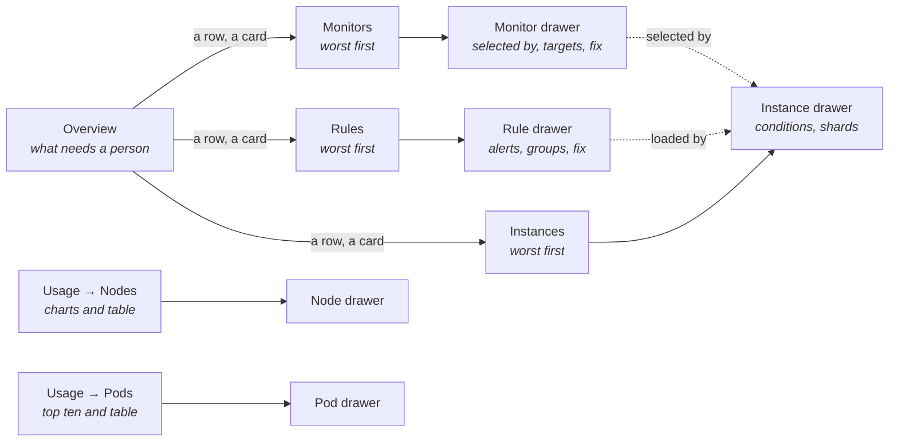
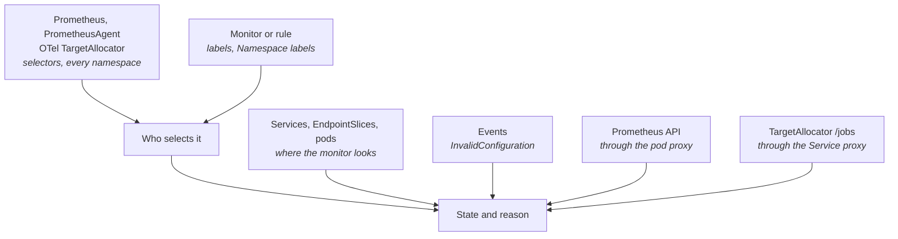

# Prometheus extension

Shows whether each ServiceMonitor, PodMonitor, ScrapeConfig and PrometheusRule of the
[Prometheus Operator](https://github.com/prometheus-operator/prometheus-operator) is picked up and
working, and how nodes and pods use their resources. A monitor no Prometheus selects, or one whose
selector or port finds nothing, is ignored in silence: no status, no target. The extension works out
who selects each object, checks what it points at, and asks the selecting Prometheus what it scrapes
and what fires.

## Contents

- [Pages](#pages)
- [Where the answers come from](#where-the-answers-come-from)
- [Usage and the cluster's metrics setting](#usage-and-the-clusters-metrics-setting)
- [Features](#features)
- [Actions](#actions)
- [What it will not do](#what-it-will-not-do)

## Pages

The group appears only where a `monitoring.coreos.com` CRD the pages read exists. Every page but
Nodes has the host's namespace selector; instances are read in every namespace, since a selector in
one takes objects in others.

## Where the answers come from

| Fact | Source |
|------|--------|
| Selected by | Each instance's object and namespace selectors, with the operator's defaults; `status.bindings` decide where reported |
| Namespace excluded | Labels match, namespace selector does not; the row names the instance |
| What it points at | The Services or pods the selector matches, whether they carry the port, and their EndpointSlices. A live target up outweighs a stale list |
| Rejected | The operator's `InvalidConfiguration` Events or a refusing binding, read every minute. Once Events expire the row reads Not loaded |
| Live health | `targets`, `scrape_pools` and `rules` of each selecting Prometheus, one ready pod per shard. An unread shard makes the row Unknown |
| Taken by a TargetAllocator | Its `/jobs` only. A job reads Unknown, since health lives in the collector |
| A rule's alerts | The loaded groups, matched to the PrometheusRule by uid |
| An instance's state | `Available`, `Reconciled`, `paused` and shard statuses |
| Where alerts go | `/api/v1/alertmanagers`. No active Alertmanager reads No Alertmanager |

## Usage and the cluster's metrics setting

The Usage pages ask the Prometheus set in the cluster's **Settings → Metrics**, through the host's
metrics route. Requests, limits and capacity come from the pod and node objects.

| Source of metrics | What to set in Settings → Metrics |
|-------------------|-----------------------------------|
| Prometheus run by the operator | Nothing; auto-detect finds it |
| Another Prometheus | Its Service, port and path prefix |
| Mimir | A proxy that adds the tenant header, with its path prefix. One tenant per cluster, or both pages warn of mixed `cluster` labels |

| Metrics | From |
|---------|------|
| Node CPU, memory, filesystem, disk, network | node-exporter |
| Pod CPU, memory, network, disk | The kubelet's cAdvisor |
| Volume use | `kubelet_volume_stats_*` |

A value with no series shows "no data", never zero, and names the missing source. When no
Prometheus answers, both pages point to Settings → Metrics.

## Features

| Page | Features |
|------|----------|
| Overview | Cards for monitors, rules and instances needing attention, each opening its list filtered; what needs attention, worst first, each row opening its drawer |
| Monitors | Kind, who selects it, what it reaches (a ScrapeConfig's static targets), live health, state and reason. Filtered, searched and sorted |
| Rules | Who loads it, groups, rules, alerts firing, state. Filtered, searched (also by a firing alert) and sorted |
| Instances | Prometheuses, agents and Alertmanagers: ready replicas, shards, Alertmanagers, state. Filtered, searched and sorted |
| Nodes | CPU, memory, filesystem and network charts per node; a table against capacity with a state for pressure or nearly full |
| Pods | Top ten pods as a chart, or those chosen; a table with use against limit or request and a state near limits |
| Monitor drawer | Who selects it and who only matches its labels, a Prometheus or agent linked to its drawer (a TargetAllocator named only); the check per endpoint; targets with their last error; the fix YAML; commands |
| Rule drawer | Who loads and selects it, linked; alerts firing and pending, failing rules, groups, fix YAML, commands |
| Instance drawer | Ready replicas, shards, selectors, Alertmanager Services and where alerts go, conditions, commands |
| Node and pod drawers | The row's figures and charts over the window, beside request, limit or capacity |

| Usage control | Behaviour |
|---------------|-----------|
| Window | 5 minutes to 7 days, moving with now; re-asked while shown |
| Custom range | A fixed start and end in local time; re-asked only by Refresh |
| Refresh | Asks again at once; the last figures stay meanwhile |
| Node and pod filters | The host's multi-select; nothing chosen means all |

## Actions

None writes; in a cluster run from Git, the fix belongs in the manifest.

| Action | Note |
|--------|------|
| Copy fix YAML | In the drawer's title bar and each row's `⋮` menu: the labels, Namespace labels, port or Service labels that fix it |
| Copy commands | The object's YAML, description, Events and the operator's refusal |

## What it will not do

- Read Secret values, or show the bearer token in the cluster's metrics setting.
- Call a TargetAllocator's `/scrape_configs`, which returns scrape credentials.
- Read Probes or ThanosRulers.
- Edit monitors, rules, instances or the metrics setting.
