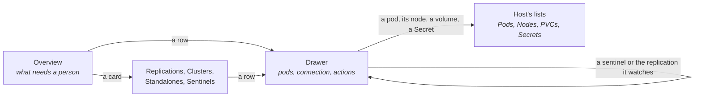

# Redis extension

Shows which objects of the [OT-Container-Kit redis-operator](https://github.com/OT-CONTAINER-KIT/redis-operator)
need attention, which pod is master, and what a failover needs. The operator records no status for a
standalone or a sentinel, so the extension judges them from their pods, volumes and events.

## Contents

- [Pages](#pages)
- [Where the answers come from](#where-the-answers-come-from)
- [Features](#features)
- [Actions](#actions)
- [What it will not do](#what-it-will-not-do)

## Pages

The group appears only where one of the operator's CRDs exists. Every page has the host's namespace
selector.

## Where the answers come from

| Fact | Source |
|------|--------|
| Master and replicas | The operator's `redis-role` label on each pod; it lags a failover by about half a minute |
| Changing master | `status.masterNode` disagrees with the labels |
| Writes refused | "Master down" when the labelled master is not ready; "No master" when no pod is labelled |
| A sentinel's state | "Watches nothing" when its replication does not exist; "Below quorum" when fewer sentinels are ready than its quorum |
| A cluster's state | `status.state` and `status.reason`; "Failed" when the operator says so, any other non-Ready state shown as is |
| A cluster stuck | Every pod ready for ten minutes while the state is not Ready; a pod back on a new IP leaves a ghost node |
| Unknown | Pods or volumes not read yet, or refused in that namespace; no write is judged on pods not read |
| TLS issuer | cert-manager's annotations on the Secret, read as metadata only, never its values |
| Recent warnings | The object's namespace events, read while its drawer is open |
| Where the operator runs | Found by its `redis-operator` image, in any namespace |

## Features

| Page | Features |
|------|----------|
| Overview | Counts by kind, down or failed, degraded; what needs attention, worst first; the replications no sentinel watches, since nothing promotes a replica if their master goes |
| Lists | State and cause, ready pods, master, sentinels, TLS issuer, image tag; filters, search and sort |
| Drawer | State, master, quorum, password and TLS Secrets, connection URLs (without the password); pods with role, node, volume, uptime, restarts and cause, plus pods left from a scale-down, marked and not counted; recent warnings, newest first; commands to copy |

## Actions

Every write asks first and reports by notification.

| Action | Note |
|--------|------|
| redis-cli | A terminal tab in a pod, with cluster mode, sentinel port and TLS as needed; the password stays inside the pod |
| Fail over | For a watched replication: a ready sentinel promotes a replica. Asks for the name |
| Scale | Replications, clusters (three leaders minimum) and sentinels; the dialog says what the new size removes or breaks. Undo puts it back |
| Restart a pod | Deletes it; it comes back on its volume. A ready pod is refused while another is down, and a watched master while its sentinels do not list every replica. Asks for the pod's name |
| Restart all | From the drawer for replications and sentinels with more than one pod; from ticked rows for replications, standalones and sentinels. One pod at a time, a replication's master last, each waiting for the set to settle with one master; the master only once its sentinels list every replica. The drawer asks for the name, ticked rows for "confirm" |
| No cluster restart | redis-operator v0.26.0 does not rejoin a pod back on a new IP; the cluster stays in Bootstrap |
| Logs | A pod's log in a log tab |
| Copy commands | `kubectl describe`, the operator's log, `cluster nodes`, the password from its Secret |

## What it will not do

- Back up or restore. The operator has neither.
- Delete a Redis object or its volumes.
- Edit ACLs or change passwords.
