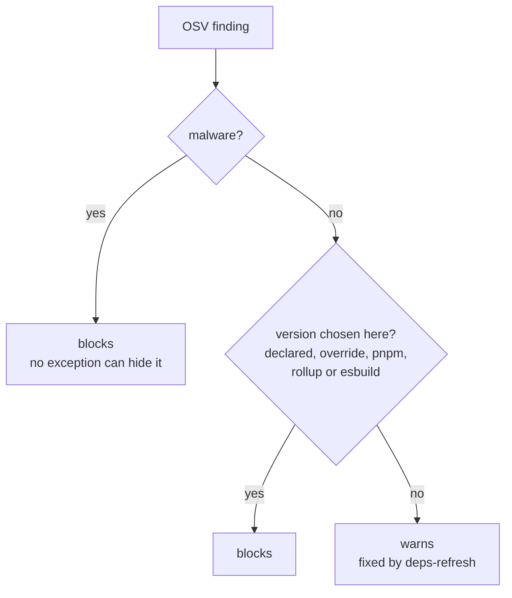

# Security

## Contents

- [Dependency age floor](#dependency-age-floor)
- [Lifecycle scripts](#lifecycle-scripts)
- [Pinning](#pinning)
- [What CI enforces](#what-ci-enforces)
- [Dependency updates](#dependency-updates)
- [Vulnerabilities](#vulnerabilities)
- [Credentials](#credentials)
- [Running the checks locally](#running-the-checks-locally)

## Dependency age floor

No version younger than 15 days is installed: compromised releases are usually found and yanked
within days. Set in `pnpm-workspace.yaml`:

```yaml
minimumReleaseAge: 21600            # minutes
minimumReleaseAgeStrict: true       # fail, rather than resolve something younger
minimumReleaseAgeIgnoreMissingTime: false
```

| Rule | Detail |
|------|--------|
| Declare ranges, not pins | pnpm picks the newest version past the floor |
| Nothing in range is old enough | Wait, or widen the range |
| Never lower the floor or add `minimumReleaseAgeExclude` | `verify-supply-chain.sh` fails |
| Checked on every install | `--frozen-lockfile` re-checks the lockfile |

## Lifecycle scripts

pnpm runs a dependency's install scripts only when `allowBuilds` sets it to `true`.

| Package | Allowed | Reason |
|---------|---------|--------|
| `esbuild` | yes | Resolves the platform binary Vite transpiles with |
| `electron` | no | Only its types are used; Freelens' container has its own Electron |
| `node-pty` | no | Same route, and nothing here uses a terminal |

## Pinning

| What | How |
|------|-----|
| Container and scanner images | `sha256` digest |
| Freelens `.deb` | `sha256sum -c` against a committed checksum; bump `FREELENS_SHA256` with `FREELENS_VERSION` |
| pnpm | `packageManager` with corepack's integrity hash |
| GitHub Actions | Commit SHA; only `actions/checkout` and `actions/setup-node`, with `persist-credentials: false` |
| Node | Copied from the official image; no downloaded script is piped into a shell |

No third-party Action runs: a new check is a digest-pinned image. Workflows default to
`contents: read`; only the release's version commit and its tag and publish jobs get `contents: write`
([distribution](distribution.md#cutting-a-release)).

## What CI enforces

| Check | Blocks |
|-------|--------|
| Supply-chain policy (`verify-supply-chain.sh`): the controls on this page | yes |
| Dependency gate (`osv-direct.sh`), before any install | see [Vulnerabilities](#vulnerabilities) |
| Secret scan (gitleaks, full history) | yes |
| Dockerfile lint (hadolint) | yes |
| Bundles (`first-party-only.ts` at build, `verify-bundles.sh` after) | yes |
| Image CVEs (Trivy) | no: they sit in Electron and Chromium, fixed only by a Freelens release |

hadolint's DL3008 (pin apt versions) is waived: Debian keeps only the current version, so the
base image digest pins the package set.

## Dependency updates

By hand, no bot. `scripts/deps-refresh.sh` resolves the lockfile again within the ranges and the floor,
in a throwaway copy, and keeps it only if the gate passes. Run it monthly; it is also how a
transitive advisory gets fixed. Never `pnpm update`: it asks to write `minimumReleaseAgeExclude`.

| Held back | Reason |
|-----------|--------|
| `vite` on 7 | electron-vite 5 supports up to 7 |
| `@types/node` | Tracks the Node in the containers |
| `react` on 17 | The host supplies it |

## Vulnerabilities

`scripts/security/osv-direct.sh` scans the whole lockfile before anything installs it: in CI, in
the release, in `make check` and in `scripts/deps-refresh.sh`.



| Topic | Rule |
|-------|------|
| Why a transitive finding only warns | Users get no third-party code: the build and `verify-bundles.sh` fail on anything from outside `src/` but the host's globals, `electron` and Node |
| Where that code runs | Build and test tooling here (vite, vitest, jsdom) |
| Overrides | None for a transitive advisory; `dompurify` and `decode-uri-component` predate the rule and now block as chosen versions |
| No fix yet | One `[[IgnoredVulns]]` per advisory in `osv-scanner.toml`, with `reason` and `ignoreUntil`; never per version, never for `MAL-` |
| The gate itself | `verify-supply-chain.sh` checks every workflow runs it first and unguarded, and tests it on probe lockfiles |
| A scanner failure | Blocks |

## Credentials

| Item | Rule |
|------|------|
| Kubeconfig | Mounted read-only; its path lives in the git-ignored `.env` |
| `.env.example` | Placeholders only |
| `FIXTURE_REDACT_DOMAINS` | Keeps private hostnames out of fixtures ([testing](testing.md#fixtures)) |
| Paths | Nothing refers to a location on a developer's machine |

## Running the checks locally

```bash
make check                       # CI's first jobs, the dependency gate first
bash scripts/security/scan.sh    # gitleaks, OSV, hadolint: the images CI uses
```

Both need Docker and `jq` on the host. The scanner digests in `scan.sh`, `ci.yaml` and
`release.yaml` must match; `verify-supply-chain.sh` fails on the OSV one if they differ.
