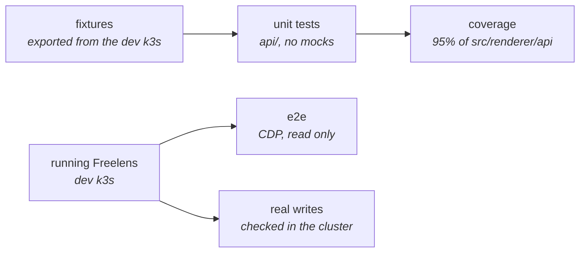
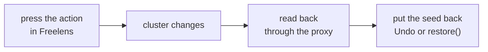
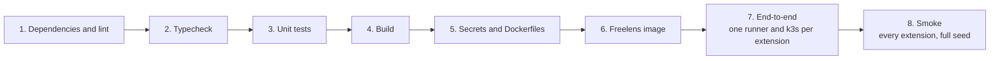

# Testing

## Contents

- [Layers](#layers)
- [Commands](#commands)
- [Unit tests](#unit-tests)
- [End-to-end](#end-to-end)
- [Real writes](#real-writes)
- [In CI](#in-ci)
- [Fixtures](#fixtures)
- [Rules](#rules)

## Layers



| Layer | Covers | Runs in |
|-------|--------|---------|
| Unit | Every decision in `src/renderer/api/` | `make check`, CI |
| Bundle check | Bundles Freelens would skip, and code from outside each extension's `src/` | `make check`, CI |
| End-to-end | Pages, controls, numbers, layout and design in the real app | `make e2e`, CI on `main` |
| Real writes | Each write done through the UI, its effect read from the cluster | `make e2e-writes`, CI on `main` |

## Commands

The cluster commands are in [development](development.md#commands).

| Command | Runs |
|---------|------|
| `make check` | Unit tests with coverage, among CI's first jobs |
| `make e2e` | Every package's suites, one package at a time; a failure does not stop the next |
| `make e2e PACKAGE=cnpg` | One package's suites; `make cluster PACKAGE=cnpg` gives it the cluster its CI leg has |
| `make e2e PACKAGE=cnpg FILES=clusters/` | Only the files whose path matches: a file (`layout`) or a folder |
| `make e2e-writes [PACKAGE=cnpg]` | Real writes; a package without any is skipped |

Watch one package's unit tests:

```bash
docker compose -f dev/docker-compose.yml --project-directory . \
  run --rm --no-deps --entrypoint sh -w /workspace freelens \
  -lc "cd packages/argocd && pnpm test:watch"
```

## Unit tests

| Topic | Rule |
|-------|------|
| Host | `@freelensapp/extensions` resolves to `test/support/freelens-host.ts`, the real `KubeObject` and `KubeApi` |
| Layout | `src/renderer/api/` has a folder per page, `shared/` and `writes/`; `test/` mirrors it |
| Support | `test/support/` holds the host and fixture helpers; `test/fixtures/` the export |
| Coverage | 95% of statements, branches, functions and lines in `src/renderer/api/` |
| Excluded | Modules that only declare, register or send, such as `shared/types.ts` and `writes/actions.ts`; the list is in each package's `vitest.config.ts` |
| React pages | Covered by the e2e suite and `verify-bundles.sh` |

A case starts from a real fixture and changes only the field under test:

```ts
const stuck = variantOf("guestbook", (data) => {
  statusOf(data).operationState = {
    phase: "Running",
    startedAt: new Date(NOW - 20 * 60_000).toISOString(),
  };
});

expect(getAttentionItems([stuck], NOW)[0]?.headline).toBe("Sync stuck");
```

## End-to-end

`make e2e` restarts Freelens with a loopback debugging port and drives it over the Chrome DevTools
Protocol. Freelens loads every extension; `PACKAGE` and `FILES` narrow only the suites.

| Path | Holds |
|------|-------|
| `build/e2e/cdp.ts` | The protocol client |
| `build/e2e/freelens.ts` | Frame, sidebar, namespace scope, menus, dialogs; `leaveNothingBehind`, `freshClusterFrame` |
| `build/e2e/design.ts` | `designViolations()` and `dialogColourViolations()` |
| `build/e2e/writes.ts` | Helpers for [real writes](#real-writes) |
| `packages/<name>/e2e/` | The extension's suites, one folder per page |

| Folder of `e2e/` | Checks |
|------------------|--------|
| `shared/` | Every page: `pages-render`, `layout`, `namespace-scope` |
| `overview/` | Cards and numbers against the cluster, read through the host's proxy |
| One per page | The list, row menu, controls and drawer match the cluster and the standard |
| `selection/` | Ticked rows: the bulk dialog, what it skips and why |
| `flow-*` | One flow start to end (ArgoCD pin, cert-manager renewal) |
| `writes/` | [Real writes](#real-writes) |
| `support/` | The package's shared setup |

Read-only suites press a write up to its confirmation and cancel.

## Real writes

`make e2e-writes` runs each package's `e2e/writes/*.writes.ts`. Each write goes through the UI, as
a person would; the test then reads the result from the cluster.



| Rule | Why |
|------|-----|
| Only the dev k3s | `openWorkbench` refuses any other cluster |
| Each test leaves the seed as it found it | Undo where there is one, else `restore()`, registered with `putBackWith` so it runs however the test ends |
| A delete only for an object the test can recreate as seeded | CloudNativePG's Subscription is the one case |

| Package | Writes |
|---------|--------|
| ArgoCD | Refresh, sync, terminate, roll back, freeze and resume, Image Updater edits |
| cert-manager | Renew |
| CloudNativePG | Back up, reload, switchover, restart, hibernate, maintenance window, schedules, poolers, subscriptions |
| MongoDB | Switch primary, scale, restart |
| Redis | Failover, scale, restart |
| OpenTelemetry | Restart |

Trivy and Prometheus write nothing. CloudNativePG's volume-snapshot backups have unit tests only:
the dev k3s has no VolumeSnapshotClass.

## In CI

One workflow, `.github/workflows/ci.yaml`; each job runs only if the one before passed. The release
calls it before it tags ([distribution](distribution.md#cutting-a-release)).



| Job | When | What |
|-----|------|------|
| 1–6 | Every pull request and push | Checks, unit tests, build, scans and the Freelens image |
| 7 | Push to `main`, by hand, and from the release | One leg per extension: `make cluster`, `make e2e`, `make e2e-writes` with its `PACKAGE`. A failing leg does not cancel the others; it prints logs and cluster state |
| 8 | After every leg passed | Every `pages-render` suite in one window on the full seed, as a person who installs them all |

`scripts/checks/e2e-legs.sh` fails unless the legs, `packages/` and the `NEEDS` map in
`dev/cluster/cluster.sh` name the same extensions.

`make ci-local` runs the workflow through [act](https://github.com/nektos/act) on a copy of the tree,
as another compose project, so the dev setup keeps running.

| Variable | Effect |
|----------|--------|
| `JOB=lint` | One job |
| `JOB=e2e LEG=cnpg` | One leg; legs run one at a time, each from a clean setup |
| `JOB=smoke` | The smoke run |
| `KEEP=1` | Leaves the last cluster and Freelens up |

## Fixtures

```bash
dev/cluster/cluster.sh fixtures          # every package
dev/cluster/cluster.sh fixtures argocd   # one
```

| Rule | Detail |
|------|--------|
| Dev k3s, full seed | Refuses any other cluster, or one missing a component (as after `PACKAGE=`) |
| Sanitised | `dev/cluster/fixtures/sanitise.py`; read the diff before committing |
| Trivy namespaces | Only those in `TRIVY_NAMESPACES` in `export.sh`; a new Trivy case's namespace goes there |
| Prometheus | Also what each Prometheus API answers, and each TargetAllocator's job names |

| Removed or replaced | Reason |
|---------------------|--------|
| Node IPs, UUIDs, domains in `FIXTURE_REDACT_DOMAINS` | Identify the host |
| `env` values, `envFrom`, credential flags in `args`, exporter and remote-write headers, tokens, proxy URLs | Credentials |
| Secret `data`, ACME keys, certificate requests, last-applied annotations | Secrets, and addresses inside base64 |
| `managedFields`, sync results, SBOM components | Size |

The full list is `sanitise.py`. `metadata.selfLink` is filled in, since `KubeObject` needs it.

## Rules

| Rule | Why |
|------|-----|
| No mocks | The real classes catch shapes a stand-in gets wrong |
| Never hand-write a fixture | Cause the state in the component's `states.sh` |
| Time-dependent code takes `now` | Tests pass the export's time, from `exported-at.json` |
| A new test fails without its fix | Check by reverting the fix |
| e2e sets up its own state | Freelens remembers sidebar groups and the namespace scope |
| No leg inherits state | Each leg seeds its own k3s and starts its own Freelens |
| Wait for a late state in `settle.sh` | Never with a longer timeout in a test |
| `make e2e` has the Prometheus operator emit its rejections again | Those Events expire after an hour |
| Prometheus pages mark `data-live="read"` | Suites wait on it instead of sleeping |
| e2e follows a person's order | Narrow, look, widen, look |
| Change a loading path, run every `namespace-scope` suite | The hooks share one pattern |
