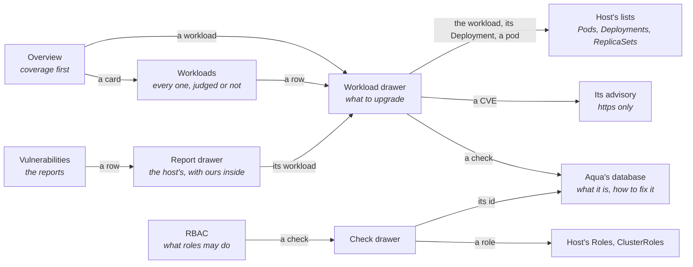
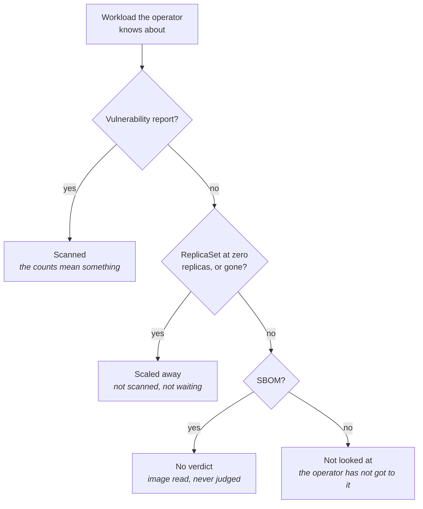

# Trivy extension

Shows whether the Trivy operator scanned each workload, then what it found. In a list of reports a
workload with no report looks the same as a clean one; this extension tells them apart. It writes
nothing to the cluster.

## Contents

- [Pages](#pages)
- [Coverage](#coverage)
- [Scan progress](#scan-progress)
- [Features](#features)

## Pages

Every page has the host's namespace selector. ClusterRoles stay listed whatever is selected.

## Coverage

| Rule | Detail |
|------|--------|
| A refused list is never an empty one | Refused everywhere, the page shows its alarm; refused in some namespaces, a banner names them and the counts leave them out |
| Reports are watched | Each kind as soon as its list lands; only failed kinds are listed again |
| SBOMs are polled | Read as metadata only and listed again every minute, sooner after a refusal |

## Scan progress

| State | When |
|-------|------|
| working | Workloads wait for a verdict and the judged count rose recently; the estimate comes from the rise over the last hour the page watched |
| stalled | Workloads wait and the count has not risen |
| stale | All judged, but some report is older than its `report-ttl` (24 hours by default) |
| complete | All judged and fresh; no banner shows |

The banner gives the age of the newest and oldest verdicts. Stalled and stale add read-only
commands: where the operator runs, its scan Jobs, its errors.

## Features

| Where | Features |
|-------|----------|
| Overview | Critical findings headline (a minimum while any workload lacks a verdict); scan progress; cards that open Workloads on a filter whose rows add up to the card; workloads waiting on a verdict; most exposed workloads |
| Workloads | Every workload with kind, namespace, coverage and counts added across its containers; a ReplicaSet's Deployment in its tooltip and search; filters All, No verdict, Findings, or a card's count |
| Workload drawer | State and what clears it; last scan; findings by severity and how many have a fix; upgrades that clear critical and high findings; pods; containers with an end-of-life base marked; failing config checks; exposed secrets, never the matched text; copy for a ticket when an upgrade clears a critical or high finding |
| Vulnerabilities | The host's list of reports by workload, container, namespace and image; its drawer adds the image, container, registry, base, counts and a link to the workload drawer |
| RBAC | One row per failing check with how many roles fail it; a check's drawer gives the fix and each role with what it grants. Roles or ClusterRoles whose reports cannot be listed are left out under a banner |
